# Build Log

Written honestly, mistakes included. Some dates are reconstructed from memory and marked ~.
All failures in one place: [FAILURES.md](FAILURES.md).

---

## ~Nov 10, 2026 — Choosing parts

Started with zero power-electronics knowledge. Considered a ready-made ESP32 drone kit, but it couldn't ship to my address, so I'm building from individual parts.

- **Brushed coreless motors (8520), not brushless.** Brushless needs a 3-phase ESC per motor; brushed motors can be driven by a single transistor or an H-bridge. Cheaper and simpler.
- **DRV8833 modules** as the first motor driver: ready-made, nothing extra to solder. (Replaced later — see Nov 17.)
- **XIAO ESP32-S3.** Small, has battery pads, and enough memory for TinyML later.
- Bought **6 motors** — 4 + 2 spares. That turned out to be too few (see ~Nov 20).
- **Learned:** what a MOSFET is (an electronic valve controlled by a weak signal), why an ESP32 pin can't drive a motor directly (~20–40 mA vs ~1–2 A), what PWM duty cycle and frequency mean, what C-rating and AWG mean.

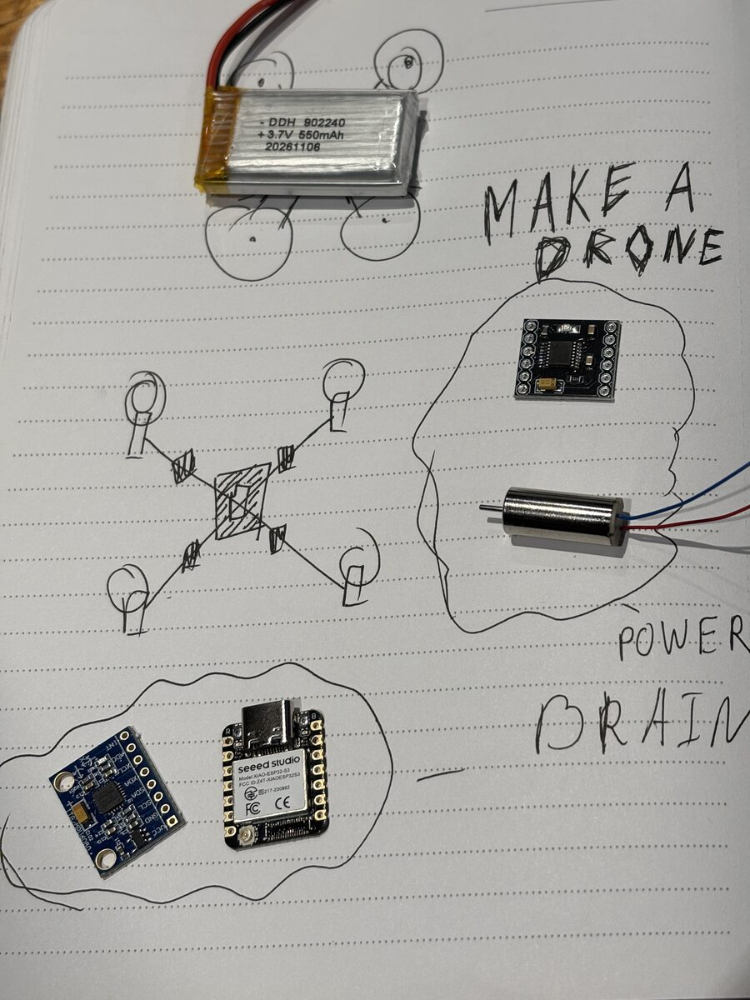

*The plan on day one: the parts laid on the sketch — "power" (driver + motor) and "brain" (MPU6050 + XIAO).*

## Nov 14 — First motor spins

- Learned PWM in the Wokwi simulator with an LED as a stand-in for the motor.
- Flashed MicroPython onto the XIAO. First attempt didn't take — the board was still running the factory demo. Reflashed in bootloader mode (hold BOOT while plugging in).
- Wired XIAO → DRV8833 → motor. Nothing happened.
- **Bug:** I used `Pin(0)`. On the XIAO ESP32-S3, the label **D0 is GPIO1** — GPIO0 is the BOOT button pin. Changed to `Pin(1)` and the motor spun.
- **Learned:** board labels (D0, D1…) and GPIO numbers are not the same thing.

▶ [Video: first motor spinning](media/videos/v01-first-motor-spin.mp4)

## Nov 14 — Driver overheating

- With a propeller on, a single DRV8833 channel got too hot to touch.
- **Fix:** parallel mode — both H-bridges of one chip drive one motor (IN1+IN3, IN2+IN4, OUT1+OUT3, OUT2+OUT4).
- **Learned the hard way:** never join OUT1 with OUT2 — they're the two ends of the same bridge; joining them is a short circuit.

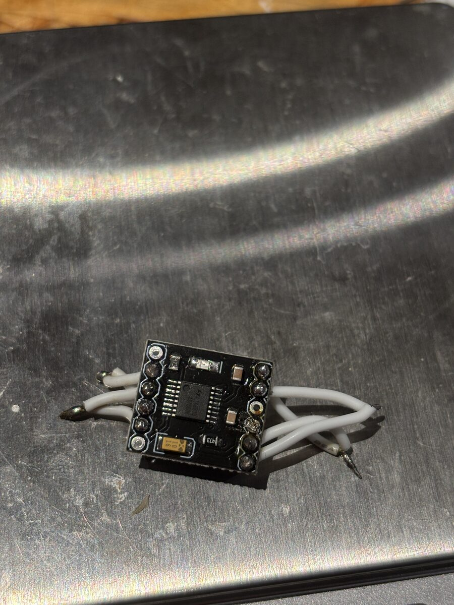

## Nov 15 — Four motors on a breadboard, weight vs thrust

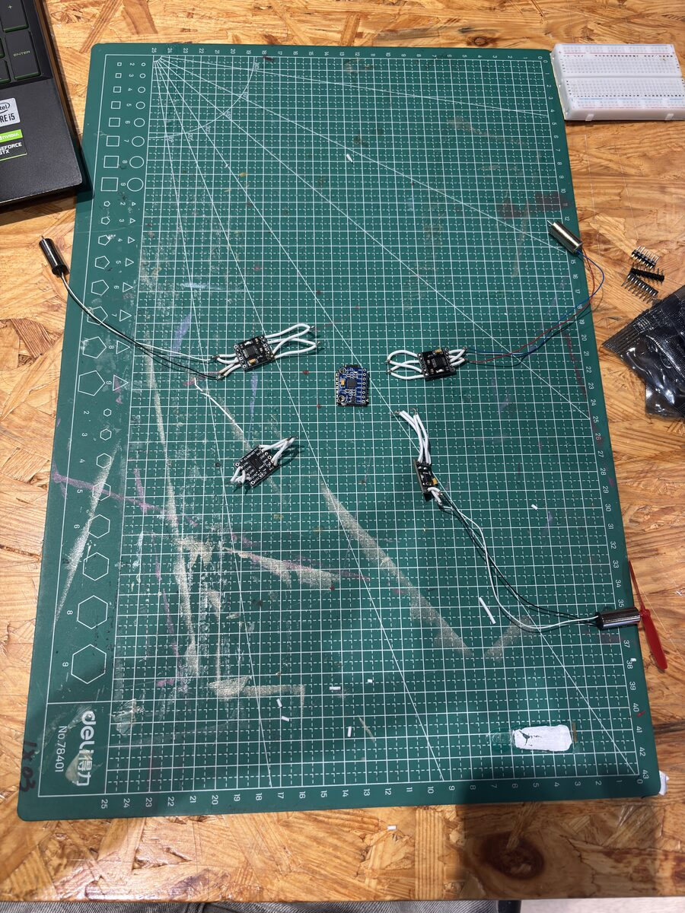 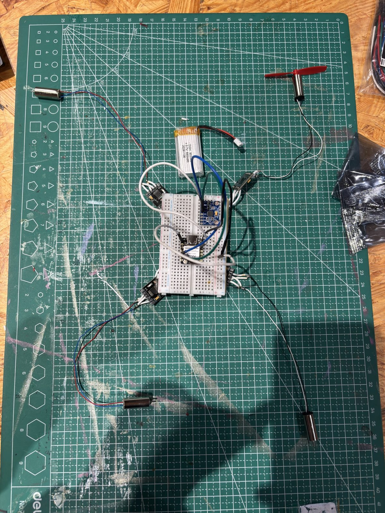

- Four DRV8833 modules, XIAO and MPU6050 on one breadboard — the first "drone" was a mess of wires on a cutting mat.
- Weighed parts: motor 5.1–5.2 g, DRV8833 with wires 2.1 g, XIAO 2.1 g. Need roughly 2× the drone's weight in thrust to fly with control.
- Worked out the budget on a whiteboard: motors 4 × 5.1 = 20.4 g, battery ~15 g, ESP 2 g, IMU 2 g, driver ~3 g → **~42 g of parts**, ~52 g with frame and wires, so **~105 g of thrust minimum**. Four motors at ~30 g each ≈ 120 g — enough on paper.

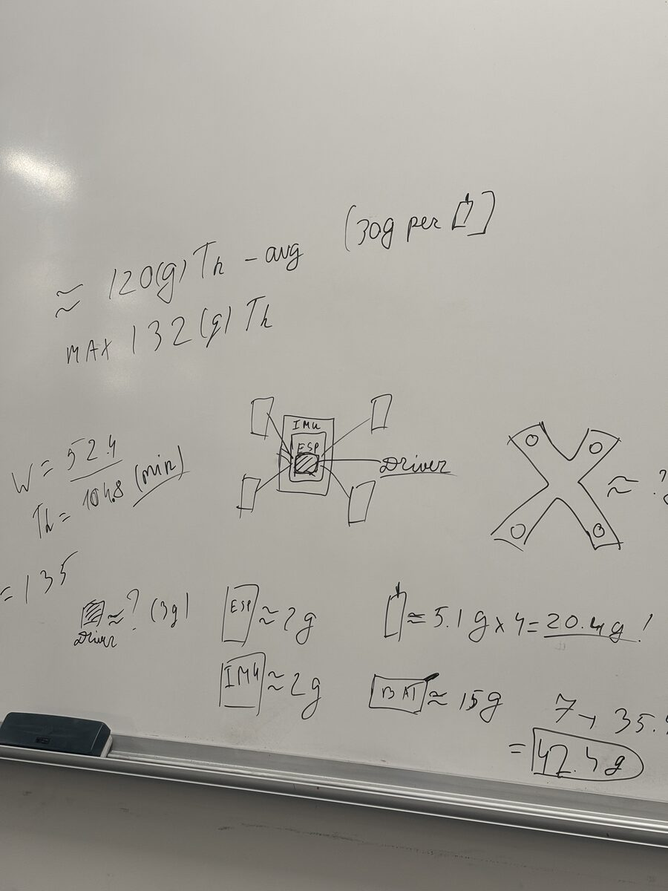
- Published thrust for 8520 + 55 mm props ranges from 20 to 34 g per motor. **Lesson:** don't trust one number — measure.
- **Ripped the wires out of a motor's end cap.** These cheap motors' weakest point is exactly where the wires enter the base — once torn, it's very hard to solder them back (you have to push solder into the tiny hole so it bonds).

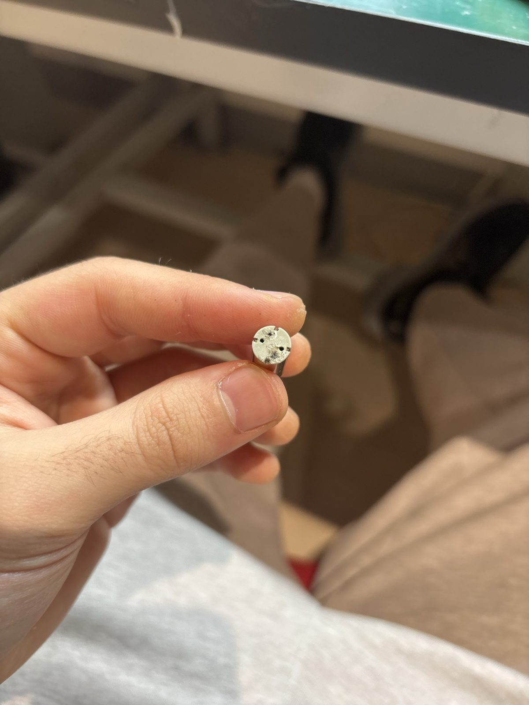

- Same `Pin(0)` bug came back in a new file. Started defining `D0 = 1` at the top of each script.

## Nov 16 — MPU6050 working

- Learned I2C: two wires (SDA, SCL), devices have addresses, data lives in registers.
- `i2c.scan()` returned `[104]` = 0x68, the MPU6050's address.
- **Gotcha:** the MPU6050 boots asleep and returns zeros. Writing 0 to register 0x6B wakes it.
- Read 14 bytes from register 0x3B and decoded them with `struct.unpack('>hhhhhhh', ...)`.
- First reading lying flat: Z = 16384 → exactly 1 g, X and Y ≈ 0, gyro ≈ 0, temperature ≈ 24 °C. Physics checks out.
- **Bug:** `ENODEV` — SDA and SCL were swapped in code vs wiring. On the XIAO, SDA = GPIO5 (D4), SCL = GPIO6 (D5).

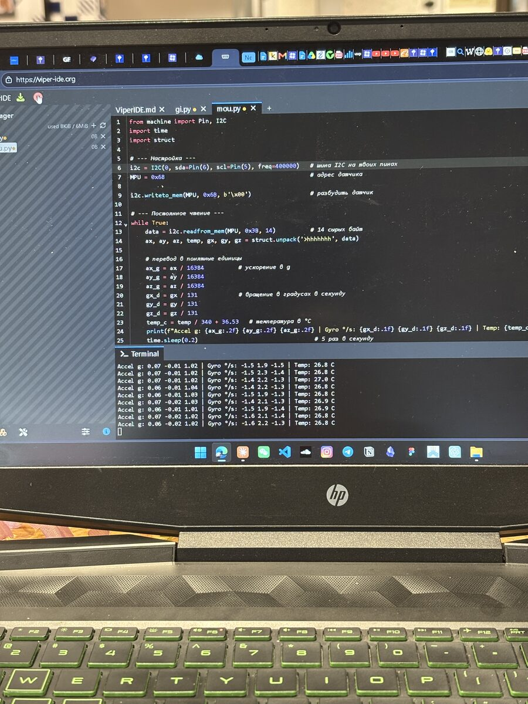

▶ [Video: working with the MPU6050](media/videos/v08-mpu6050-work.mp4)

## ~Nov 17 — Thrust test: the driver was the bottleneck

One 8520 motor + 55 mm prop on a kitchen scale (motor upside down, pushing the scale):

| Driven by | Thrust |
|---|---|
| DRV8833 (parallel mode) | ~19.5–20 g |
| Battery connected directly | ~35 g |

Almost half the thrust was lost in the driver. On a 1S battery (3.7–4.2 V), the DRV8833's internal switches (~0.36 Ω in the current path) eat the voltage the motor needs. Four motors × 20 g ≈ 80 g of thrust for a ~55 g drone — barely 1.5 : 1, not enough to fly with control.

- **Lesson:** a part can be "rated for 3 A" and still be the wrong part — check its resistance at *your* voltage.

▶ [Video: thrust test on the kitchen scale](media/videos/v03-thrust-test-on-scale.mp4)

## ~Nov 17 — MOSFET bench test with parts from the lab cabinet

| Searching the lab drawers | Found the IRLB8721 |
|---|---|
| 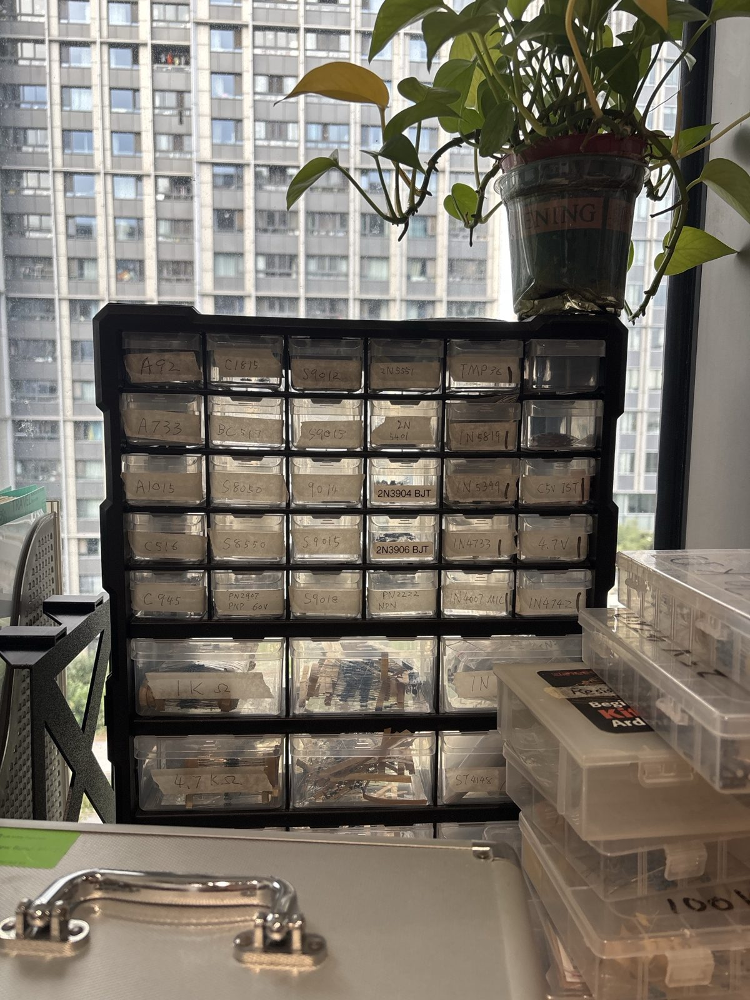 | 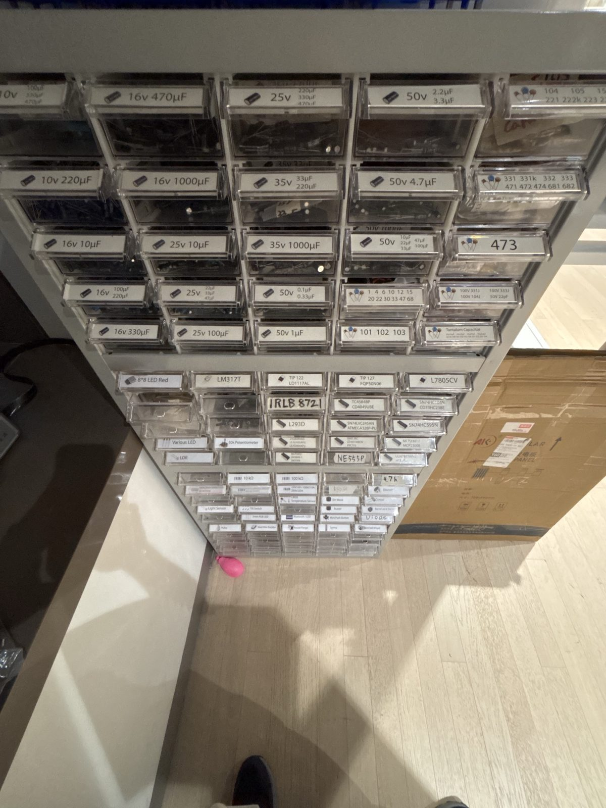 |

- Built one low-side switch: IRLB8721 MOSFET (logic-level, TO-220) + 1N5822 Schottky flyback diode + 10 kΩ gate pull-down.
- **Result: 33 g on a charged battery, 27–28 g on a low one** — close to the direct-battery 35 g.

| Bench test | Close-up |
|---|---|
| 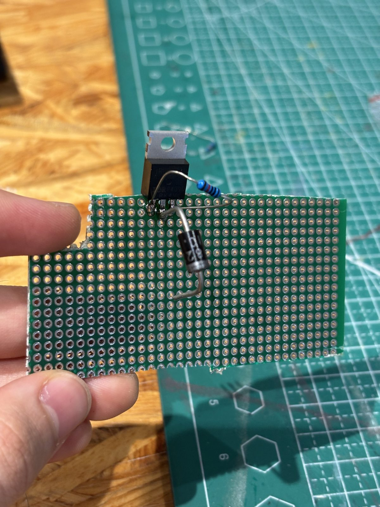 | 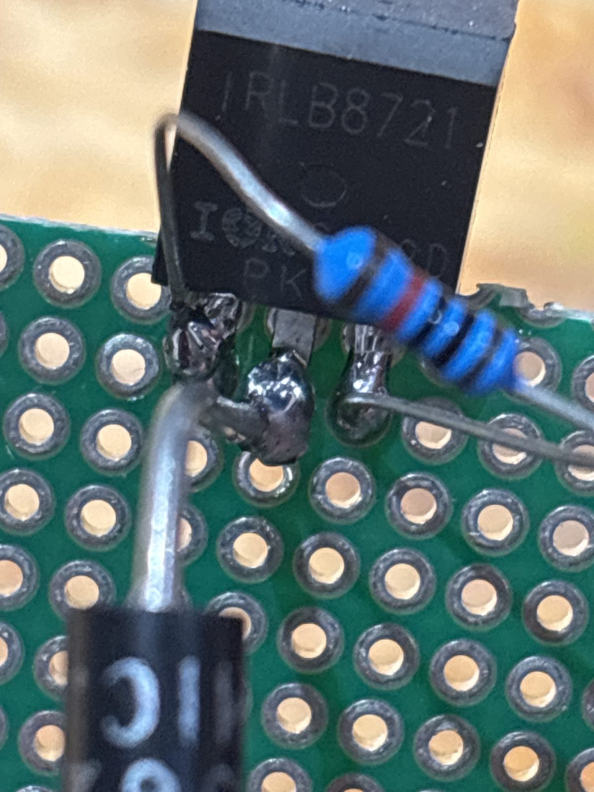 |

- **Decision:** replace the DRV8833 with one small MOSFET per motor. Ordered **AO3400A** (SOT-23, logic-level, ~43 mΩ at 2.5 V gate), **SS34** Schottky diodes, **10 kΩ 0805** resistors.
- **Learned:** low-side switch = motor between battery + and the MOSFET's drain, source to ground. The diode across the motor (stripe toward +) catches the spike when the switch turns off. The 10 kΩ keeps the gate at 0 V while the ESP32 boots, so a motor can't start by itself.
- **Learned:** how to read a datasheet — VGS(th), RDS(on) *at the gate voltage you actually have*, ID, pinout.

## ~Nov 18 — Multimeter, props, first SMD soldering

- Learned to use a multimeter (Fluke 107). First it read nonsense — it was set to **AC volts** (`0.180 V AC`). Then its battery turned out to be dead.

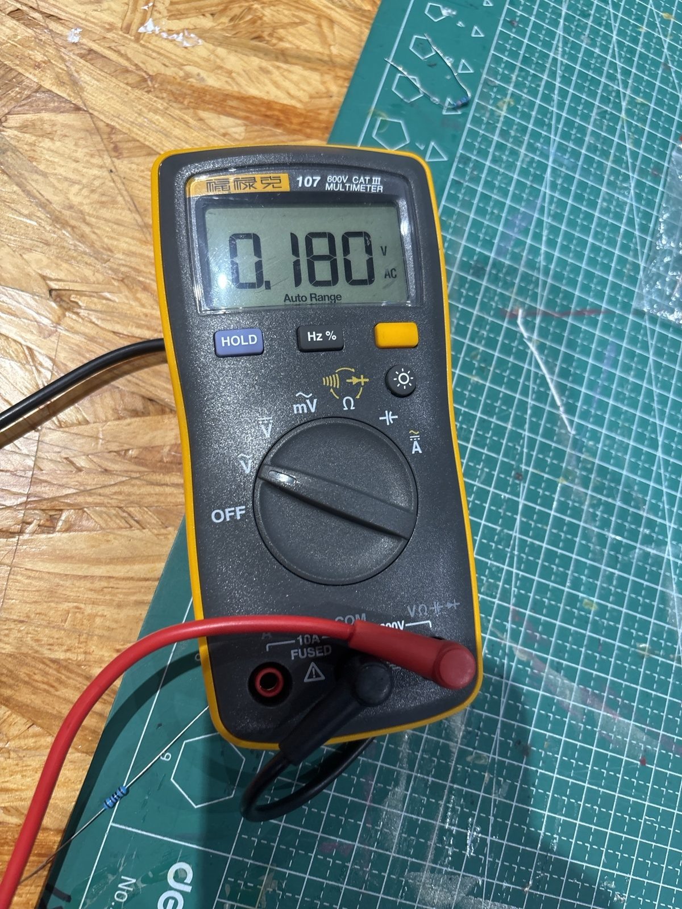

- Ordered 65 mm props; **75 mm** arrived. Kept them — comparison with 55 mm still to do.
- **First SMD attempt:** an SS34 and an 0805 resistor on perfboard — far too much solder, burnt flux, a probable short.

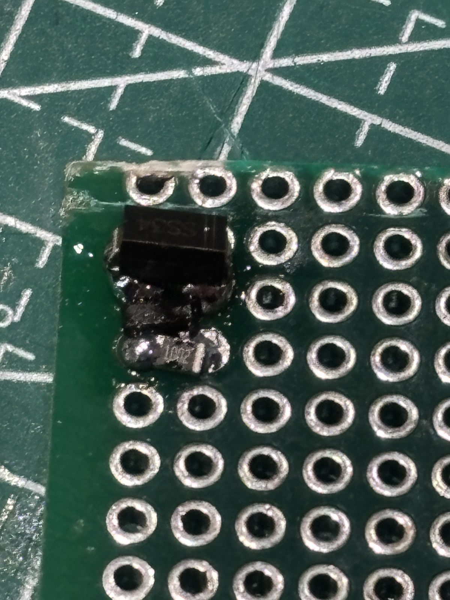

- **Lesson:** less solder, more flux, 320–350 °C, clean with alcohol, continuity-check every joint before power.

## Nov 19 — A 4-channel motor driver on 16 holes of perfboard

Goal: all four drivers on one tiny board, battery connected once.

- **Cutting perfboard** is harder than it looks: it doesn't cut, it snaps — and can crack through the piece you need. Kept a spare row: the board is **5×4** holes, the circuit uses 4×4.

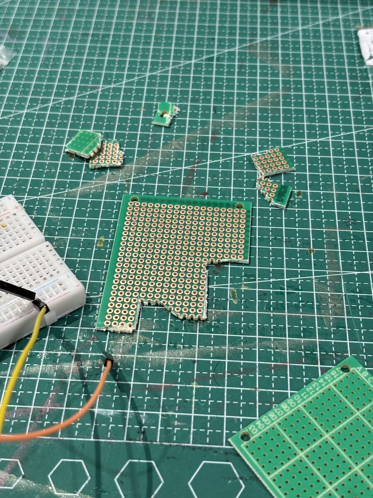

- **Problem:** AO3400A legs are 1.9 mm apart, perfboard holes 2.54 mm. On paper each transistor needs a 2×2 block — no room left for diodes.
- **Trick I found:** shift the transistor slightly sideways and all three legs just reach three holes. That freed one hole per corner.
- **Layout ("pinwheel"):** each corner is one driver; the four transistors are rotated 90° from each other; the centre 2×2 is solid ground. Diodes and resistors on the back. See [docs/driver-board.md](docs/driver-board.md).

| Top | Back |
|---|---|
| 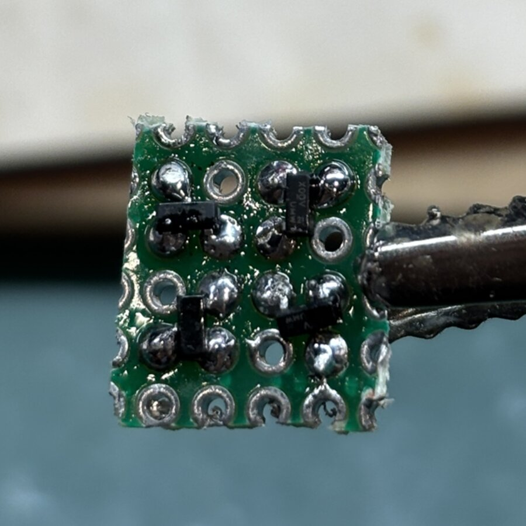 | 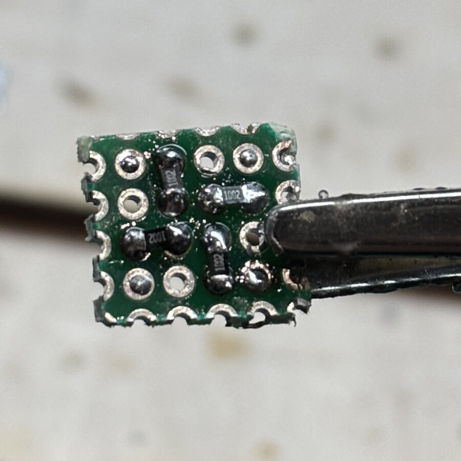 |

▶ [Video: testing the driver board](media/videos/v05-driver-board-testing.mp4)

- **Bug 1:** nothing worked. The ESP32 ground didn't beep to the board's ground — a joint that looked soldered but wasn't. Without a common ground the MOSFETs never open.
- **Bug 2:** with the battery on one pad, only motor 1 worked. The four + pads sit in four corners and **aren't connected to each other** on the board — I had missed the wire that links them. Fixed with an insulated wire looped around all four + pads:

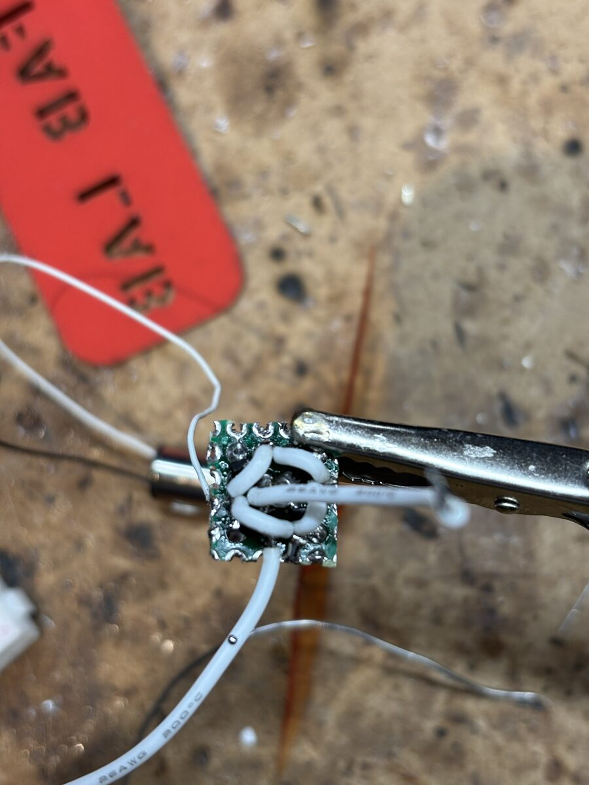
- **Lesson:** before connecting the battery, beep out every net: + to + (beep), + to ground (no beep), gate to ground (~10 kΩ), drain to ground (no beep).
- **Heat test:** two motors running on the finished board at once — no overheating.
- **Weight: 1.4 g** for the whole 4-channel driver with diodes (0.5 g before the diodes) — vs 2.1 g for *one* DRV8833 module.

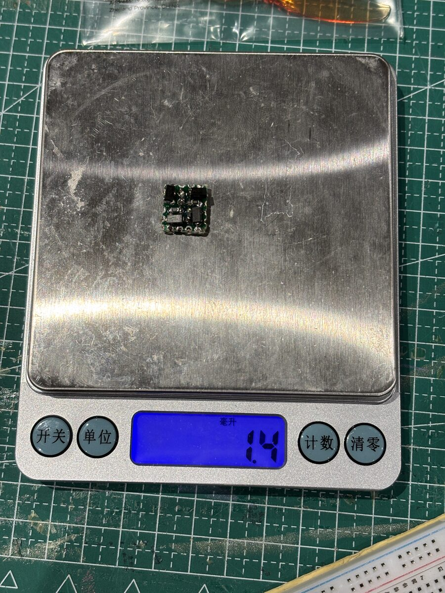

## Nov 19 — Driving four motors from code

- Scripts for two motors, four motors from one line of input (`20 0 0 0`), and one that spins them one after another.
- Motor signal pins at this point: **D0, D6, D7, D9** (GPIO 1, 43, 44, 8). Later, when everything moved onto the frame, I re-wired them — see Nov 23.
- **Safety rule:** every script sets all motors to 0 at the very start (`PWM(..., duty_u16=0)` and pins driven low first).
- **Caveat:** D6/D7 are UART0 TX/RX. The bootloader prints on TX at power-up, so a motor there may twitch before my code runs.
- Swapping a brushed motor's two wires is safe — it just spins the other way.

## ~Nov 20 — Cardboard frame

- The motors are magnets and kept snapping onto each other on the table. Cut a simple **X from cardboard**, poked holes, pushed the motors in — now they stay put, and I can see roughly what the drone will look like.
- Ran the motors one after another on it: all four work, and the wires don't get ripped out when they're pulled.

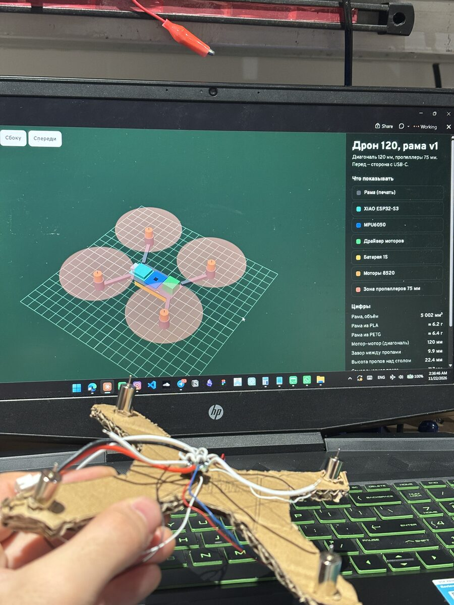

▶ [Video: motors spinning one by one on the cardboard frame](media/videos/v07-cardboard-motor-sequence.mp4) · [with props on](media/videos/v12-cardboard-props-spinning.mp4)

## ~Nov 20 — Four hours of re-soldering because of motor direction

- A quad needs two motors spinning one way and two the other (red/blue wires vs black/white). The motors that broke earlier were exactly the **opposite-direction** ones — almost all of my remaining motors spun the same way.
- Checked direction at low throttle with a finger or a prop. Re-soldered the wrong motors, then the wrong ones again, then finally the right ones.
- Every re-solder risks tearing the wires off the motor base — and re-attaching them there is the hardest joint on the whole drone.
- It was late, I was sleepy, and every mistake cost another half hour. **~4 hours** in total.
- **Lessons:** buy spares of **both** rotation directions; mark each motor's direction before soldering; glue the wires near the base; don't solder tired.

## Nov 20 — `ENODEV` again, and a loose wire

- `[Errno 19] ENODEV` — the code had `sda=Pin(6), scl=Pin(5)`: swapped again. Wrote a scan that tries both pin orders and both bus speeds ([firmware/i2c_scan_debug.py](firmware/i2c_scan_debug.py)).
- `i2c.scan()` sometimes returned `[]` and sometimes `[104]` → a loose contact. On a vibrating drone that wire would drop out mid-flight.

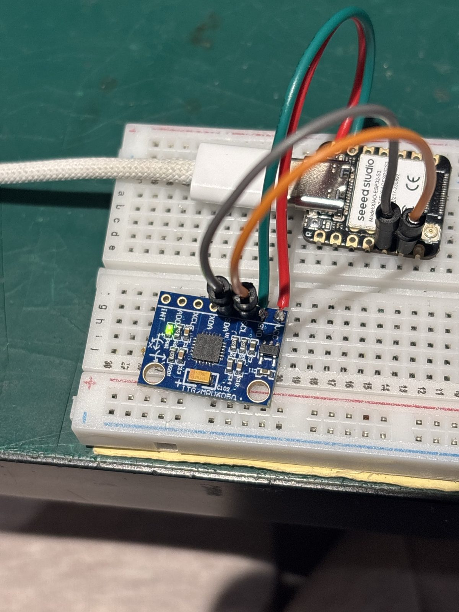

## Nov 21 — Understanding PID from scratch

Watched many videos and still didn't get it, so I worked through it with numbers on a whiteboard. Full notes: [docs/PID_NOTES.md](docs/PID_NOTES.md).

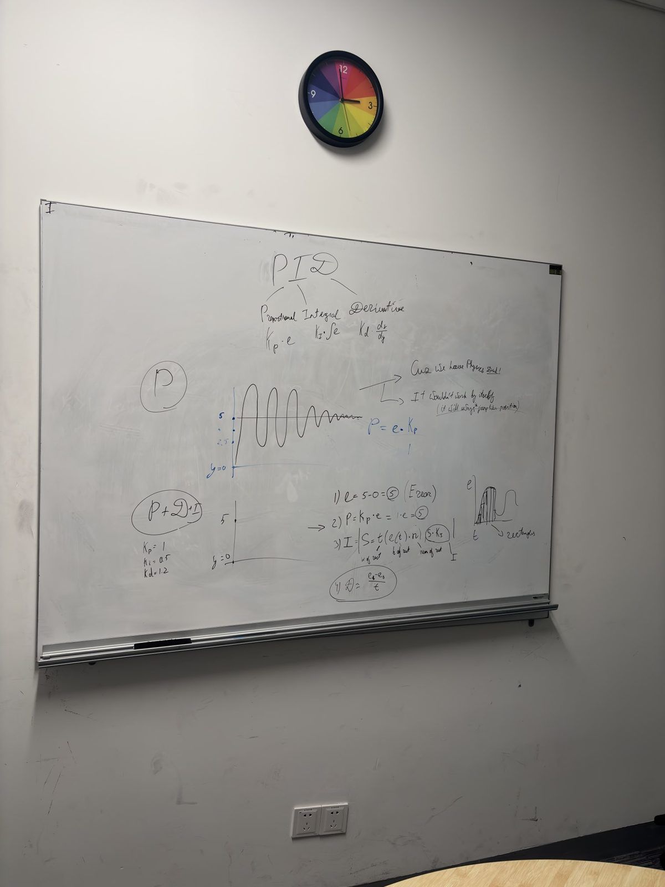

- **My misconception:** I thought PID sets the position (`y_new = y + Kp·e`, so Kp = 1 would jump straight to the target). Wrong: the controller sets **thrust**; thrust → acceleration → speed → position. A moving drone overshoots.
- **P** pushes harder the further you are — but can't brake, so it overshoots.
- **D** looks at how fast you're moving and brakes before you arrive.
- **I** is a piggy bank: it collects "error × time" and keeps pushing even at zero error. Without it, a drone with one weaker motor hangs at a constant tilt — and a tilted drone slides sideways (4° ≈ 3 m in 3 s).
- **On a computer** there's no formula to integrate — only a number every few milliseconds. Integral = sum of rectangles (`S += e·dt`), derivative = slope between the last two points (`(e − e_prev)/dt`).

## Nov 21 — Angle from the gyroscope

- **Calibration:** lying still, the gyro reads about −1.5…−2 °/s instead of 0. Averaging thousands of readings and subtracting the average fixes it. Waiting 3 s after waking the sensor changed the offset from −2.02 to −1.55 °/s.
- **Angle = sum of (rate × dt)** — the same rectangles as the integral.
- **Bugs, in order:**
  - read the sensor once, then appended the same value 500 times;
  - named variables `sum`, `len`, `time` — overwrote Python's own functions;
  - a 1-second loop: one hand-lift gave "300°";
  - 3° for a 90° tilt — I was tilting around the wrong axis;
  - `dt` was a guess (0.01) — now measured every loop with `time.ticks_us()`.
- **Result:** 90° reads 90°. Drift: **2.23° in 6 min 46 s** (~0.33°/min). Without calibration it would be hundreds of degrees.
- Don't trust the arrows printed on the sensor board — tilt it and see which number changes.

## Nov 21–22 — PID on one axis, then two axes and four motors

- Derived the motor formula myself on a stick with two motors:
  `right = throttle + Kp·angle + Ki·S + Kd·rate`, `left = throttle − (same correction)`. Checked every sign with numbers.
- Rate for D comes straight from the gyro — it *is* the derivative of the angle.
- Clamped motor outputs to 0–100 % (otherwise `duty_u16` gets an impossible value and the program crashes mid-flight).
- **The "drop" problem:** while learning, I didn't notice the I term was already on. I lifted and lightly tossed the board — the piggy bank filled up, the motor powers shifted, and **stayed shifted** after the board lay still again. That's exactly what I does: it remembers. On the table nothing ever corrects it, because the motors don't move the board.
- **Fixes:** the piggy bank is limited to ±L, with `L = I_MAX / Ki` (anti-windup); later it will also reset when throttle is low.
- **Python gotcha:** assigning to a variable inside a function makes it local — the piggy bank has to be updated in the main loop.
- **Four motors:** my first version gave diagonal motors (1 and 3) the same signs; tilting showed both diagonals pushing together. One axis splits **front vs back**, the other **left vs right**; diagonals always get opposite corrections.
- **Nov 22:** roll + pitch PID running on the ESP32 with all four motors reacting to tilt.

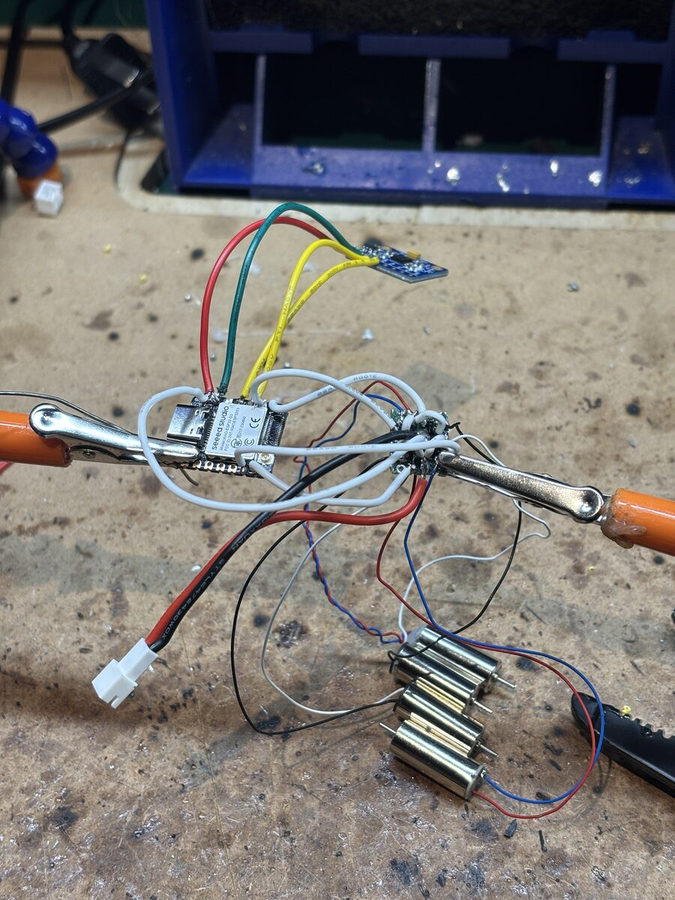

## ~Nov 22 — 3D-printed frame

- Modelled the frame (with Claude), sliced it in Bambu Studio and printed it on the university's Bambu Lab printer — **~16–20 minutes**.
- Frame v1 numbers from the model: **120 mm** motor-to-motor diagonal, **75 mm** props, **9.9 mm** gap between props, **~6.2 g** in PLA.

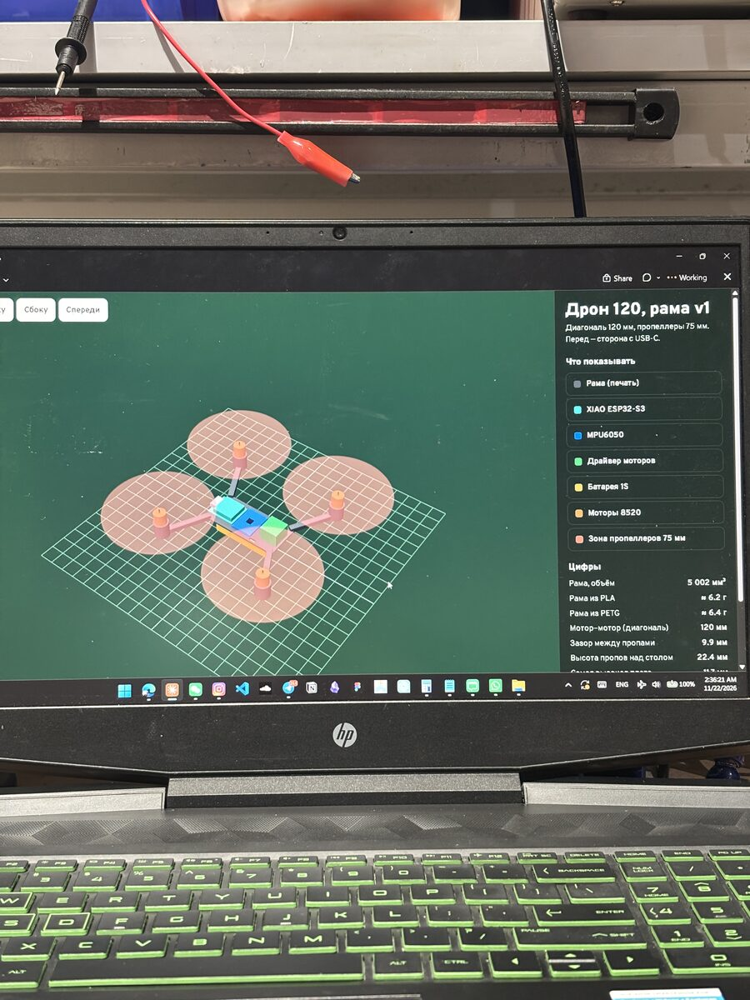
- **Fit problems:**
  - the motor holes were tight (as they should be), so a motor would suddenly slip in and seat with a jolt;
  - the wire channel under each motor **squeezed the wires** from below — the motor points down, the wires bend at the base and tear off.
- **Fix:** a cushion of hot glue under each motor — it dampens the jolt, stops the wires from bending and holds the motor in place. Some motors still had to be re-soldered — again, the hardest joint on the drone.
- **For v2:** route the wires out to the side, widen the channel, chamfer the motor holes.

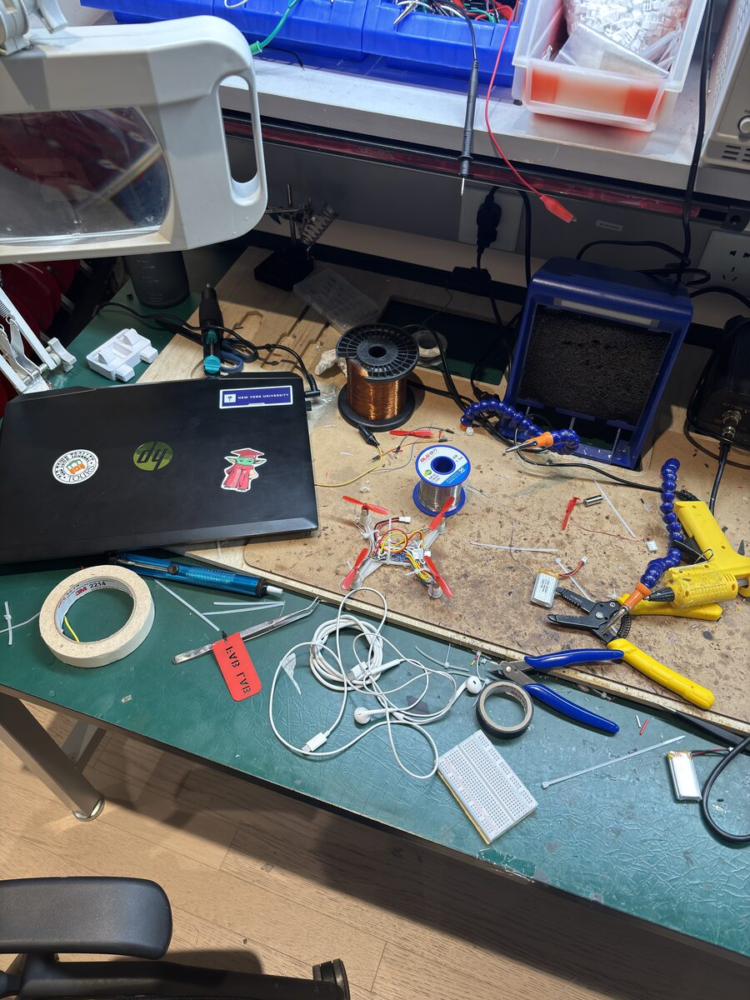

## ~Nov 22 — Running on battery

- On USB the XIAO's red LED is on; on battery **nothing lights up** — I thought the ESP32 was dead. It wasn't: the red LED is the **charging** LED, not a power LED.
- Code didn't start on its own: I'd saved it under different file names. MicroPython runs only `boot.py` and `main.py` at power-up — the flight code must be in **`main.py`**. Took an hour to find out.
- **Next safety step:** now that the code starts by itself, add a few seconds of zero throttle (or a start command) before the motors are allowed to spin.

## Nov 23 — Wrong motor numbering

- On the frame the PID output looked wrong: at rest the motors got numbers like `0, 40.9, 22.9, 0`, and tilting forward/back didn't push the right corners.
- I suspected the gyro angle, the I term, the gains. **The real problem: the motor numbering in my code didn't match the frame.** The comment in the code said "M1 front-right, counter-clockwise"; on the real frame the numbering starts at a different corner and goes clockwise. The mixer was correct — it was just sending each correction to the wrong motor.
- New wiring after moving onto the frame: motors on **GPIO 44, 7, 5, 6** (D7, D8, D4, D5), MPU6050 on **SDA = GPIO 9 (D10), SCL = GPIO 8 (D9)**.
- **Fix:** don't touch the formulas — only reorder `PINS` so each slot in `mix()` lands on its real corner. Then check with the manual test (`20 0 0 0` must spin the front-right motor) and the tilt test with motors off (`MOTORS_ON = False`): nose down → `x` grows → front motors' numbers go up.
- **Lesson:** label each motor on the frame with its number and pin *before* writing the mixer, and test the mapping one motor at a time.
- Status: still checking the forward/back axis.

---

## Next

- Test stand: drone on a stick, one axis free, props on, low throttle → tune Kp, then Kd, then Ki
- Reset the piggy bank at low throttle; startup delay before motors arm
- Accelerometer + gyro → complementary filter (no drift)
- Frame v2 (wire channels), final wiring with strain relief
- Yaw control, throttle from a phone over Wi-Fi
- First tethered hover → free hover
- Log everything (angles, rates, motor commands) — training data for RL later
