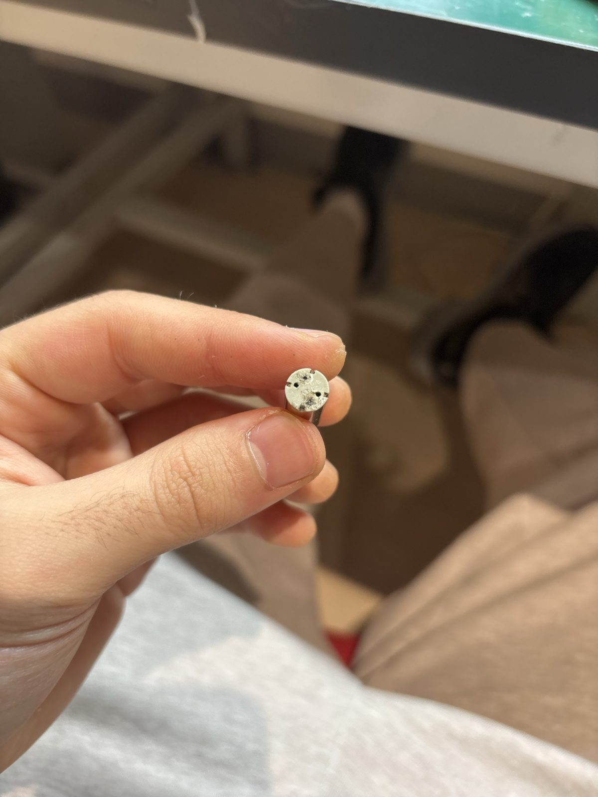
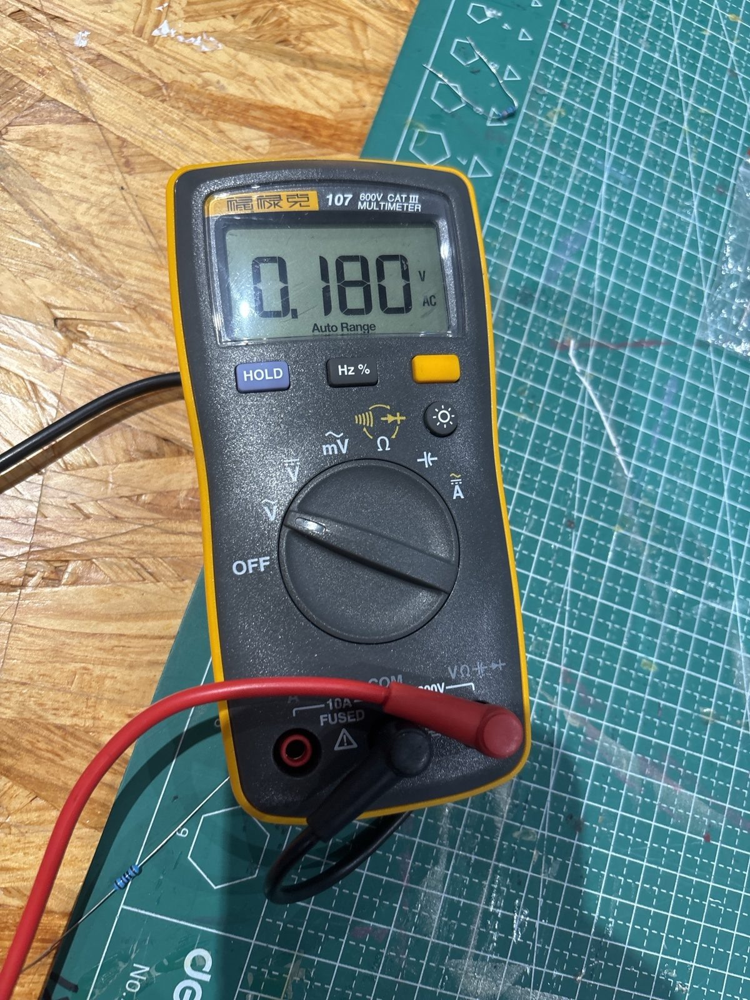
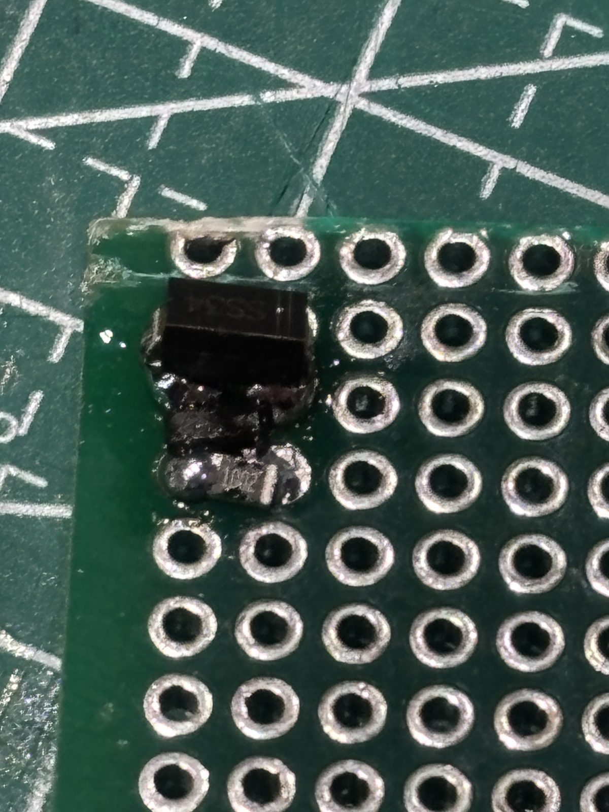
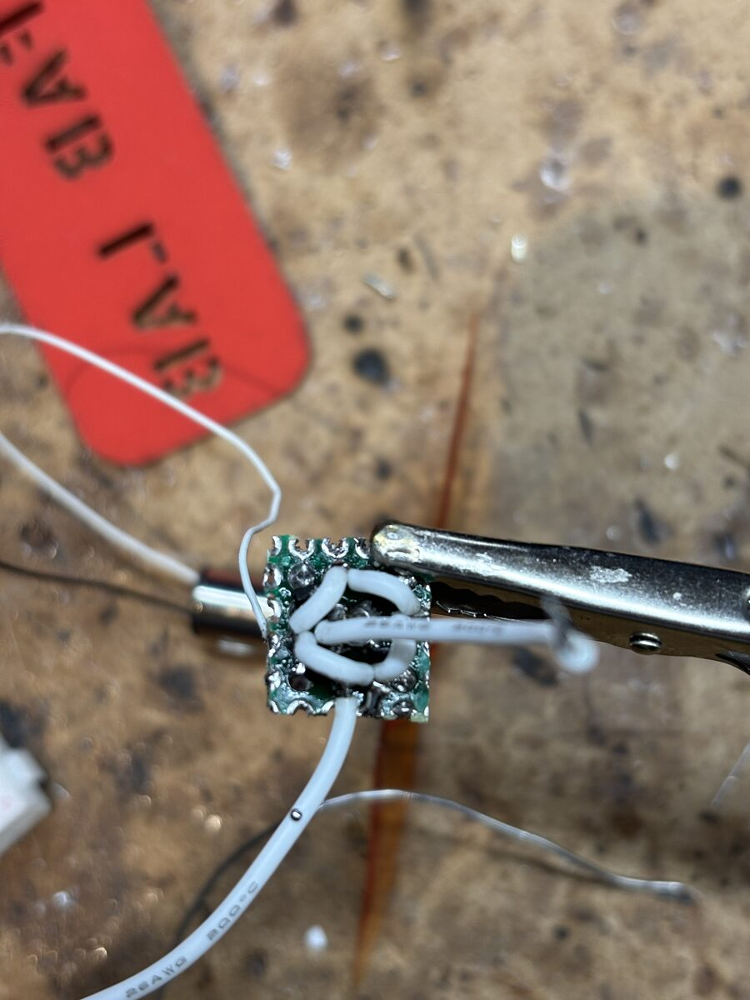

# Failures

Everything that went wrong so far, in order. Each one: what happened → what it cost → what I learned. The full story is in [BUILD_LOG.md](BUILD_LOG.md).

## Hardware

**1. The board that didn't run my code** · Nov 14
The XIAO was still running its factory demo — MicroPython hadn't actually been flashed.
→ Reflash in bootloader mode: hold BOOT while plugging in.

**2. `Pin(0)` instead of `Pin(1)`** · Nov 14, again Nov 15
On the XIAO ESP32-S3, the pin labelled D0 is GPIO1. GPIO0 is the BOOT button. The motor did nothing.
→ Board labels are not GPIO numbers. Define the mapping once at the top of every file.

**3. Overheating driver** · Nov 14
One DRV8833 channel with a propeller got too hot to touch.
→ Parallel mode helped, but it was a sign the part was wrong for this job (see 6).

**4. Torn motor wires** · Nov 15 and many times after
The wires of these cheap motors tear out of the base. Re-soldering them there is the hardest joint on the whole drone.

→ Glue the wires near the base. Never let a solder joint carry mechanical load.

**5. `ENODEV` — sensor not found** · Nov 16, again Nov 20
SDA and SCL swapped between code and wiring. Twice.
→ Run `i2c.scan()` first. If it's `[]`, swap the pins in code before touching the wires.

**6. The driver ate half the thrust** · ~Nov 17
20 g per motor through the DRV8833, 35 g straight from the battery. With four motors at 20 g the drone would barely lift itself.
→ At 3.7 V every fraction of an ohm matters. Check a part's resistance at your voltage, not just its current rating. Designed my own MOSFET driver (33 g).

**7. A multimeter that lied** · ~Nov 18
It showed `0.180 V AC` — it was on the AC range. Then the battery inside was dead.

→ Check the dial first. DC volts, continuity and diode mode are the three modes I actually use.

**8. Wrong propellers** · ~Nov 18
Ordered 65 mm, got 75 mm.
→ Kept them; to be compared with 55 mm on the scale.

**9. First SMD soldering** · ~Nov 18
Far too much solder, burnt flux, a probable short between pads.

→ Less solder, more flux, 320–350 °C, clean with alcohol, continuity-check before power.

**10. Perfboard that snaps instead of cutting** · Nov 19
It cracks along the holes and can break through the piece you need.
→ Score several times along one row of holes, then snap. Keep a spare row (my board ended up 5×4).

**11. Ground that looked soldered but wasn't** · Nov 19
Nothing worked. The ESP32 ground didn't beep to the board's ground.
→ No common ground = the MOSFETs never open. Beep out every connection, don't trust how a joint looks.

**12. The forgotten plus wire** · Nov 19
Only motor 1 worked. The four + pads are in four different corners and aren't connected on the board.
→ Beep + to + on all four pads before plugging in the battery.

**13. Not enough spare motors, and four hours of re-soldering** · ~Nov 20
Bought 6 motors (2 spares). The ones that broke were the opposite-direction ones, so almost all remaining motors spun the same way. Re-soldered the wrong motors, then the wrong ones again — late at night, sleepy. ~4 hours.
→ Buy spares of both directions. Mark each motor's direction before soldering. Don't solder tired.

**14. A 3D-printed frame that tore the wires** · ~Nov 22
Tight motor holes made the motors jump in; the wire channel squeezed the wires from below and bent them off the motor base. More re-soldering.
→ Hot-glue cushion under each motor. Frame v2: wires exit to the side, wider channels.

**15. "Is it dead?"** · ~Nov 22
On battery the XIAO shows no light at all. It was working fine — the red LED only means "charging".

## Code

**16. Code that didn't start by itself** · ~Nov 22
Saved under different file names; MicroPython only runs `boot.py` and `main.py` at power-up. An hour to figure out.

**17. 500 identical readings** · Nov 21
Read the sensor once, then appended that same value to the calibration list 500 times.
→ The line that reads the sensor must be inside the loop.

**18. Overwriting Python** · Nov 21
Named my variables `sum`, `len`, `time` — the next call to `sum()` or `time.sleep()` crashed.
→ Never reuse built-in names.

**19. A hand-lift measured as 300°** · Nov 21
The loop ran once a second, so one fast movement was counted as a whole second of rotation.
→ Read the gyro ~100 times a second and measure the real time between reads.

**20. 3° for a 90° tilt** · Nov 21
I was tilting around the wrong axis.
→ Tilt the board and watch which number changes — don't trust the arrows printed on it.

**21. The integral that wouldn't forget** · Nov 21–22
I didn't notice the I term was on. Tossing the board filled the piggy bank, and the motor powers stayed shifted afterwards.
→ That's what I does. Limit it (anti-windup) and reset it on the ground.

**22. Diagonal motors pushing together** · Nov 22
My first four-motor mixer gave motors 1 and 3 the same signs.
→ One axis is front vs back, the other left vs right; diagonals always get opposite corrections.

**23. Motors numbered differently in code and on the frame** · Nov 23
The code's comment said M1 is front-right and the numbering goes counter-clockwise. On the real frame it starts at another corner and goes clockwise. The mixer was right — every correction just went to the wrong motor, so the numbers looked like nonsense and I blamed the gyro and the PID first.
→ Label every motor on the frame with its number and pin. Check the mapping one motor at a time (`20 0 0 0`) before trusting any PID output. Fix the order in `PINS`, never the formulas.

## Not filmed

Most of these happened at 2 a.m. and I didn't think to film them. From now on: film first, fix second.
