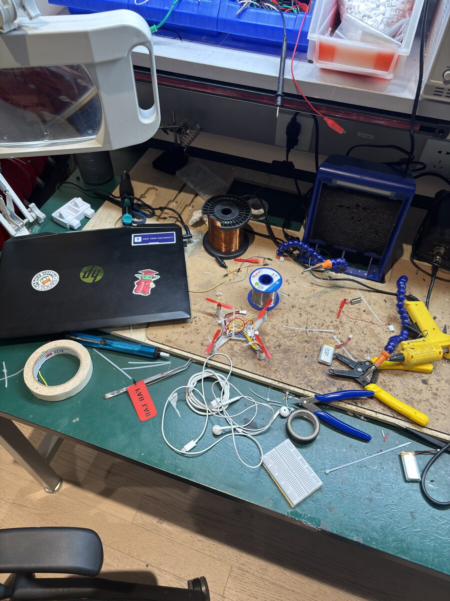
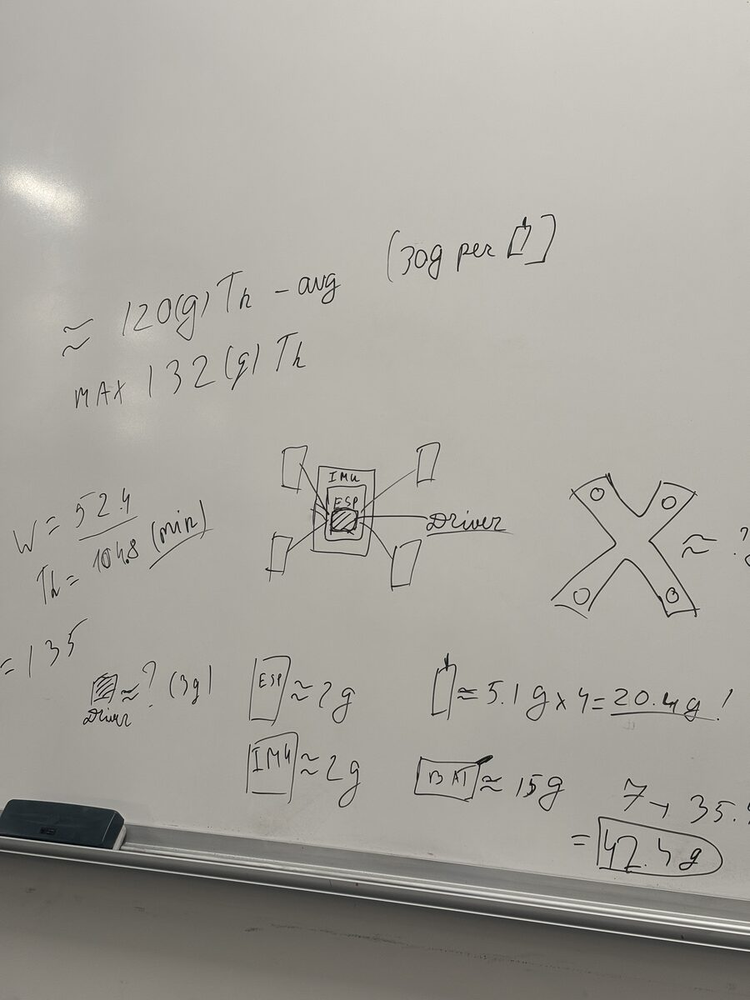
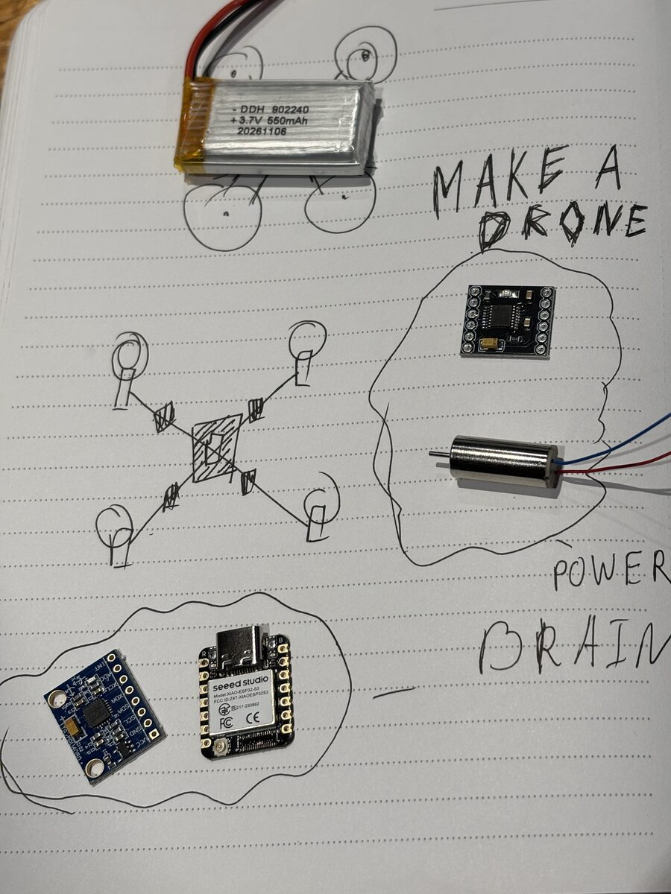
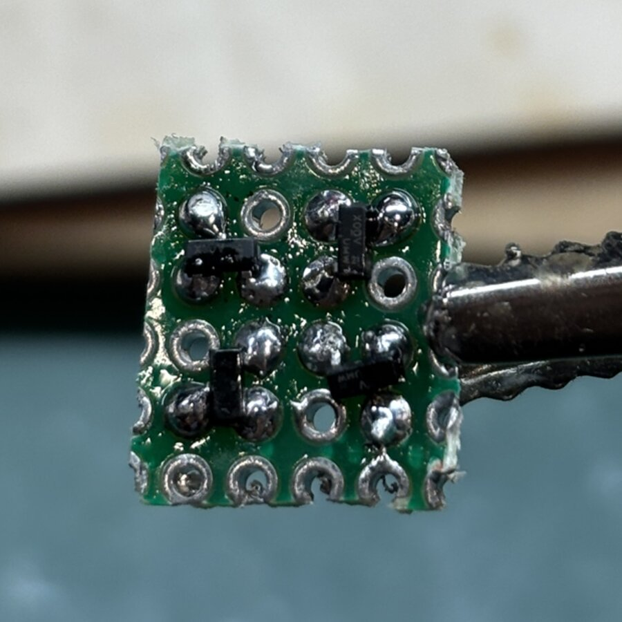
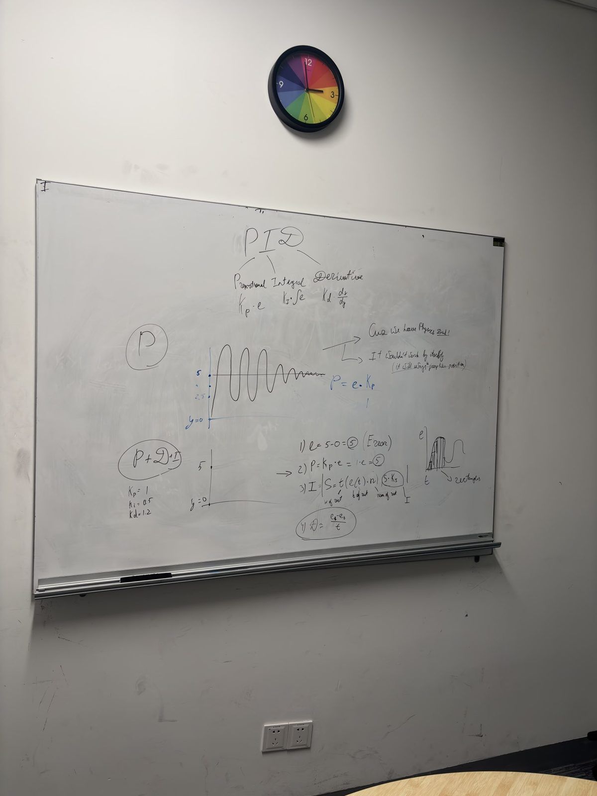
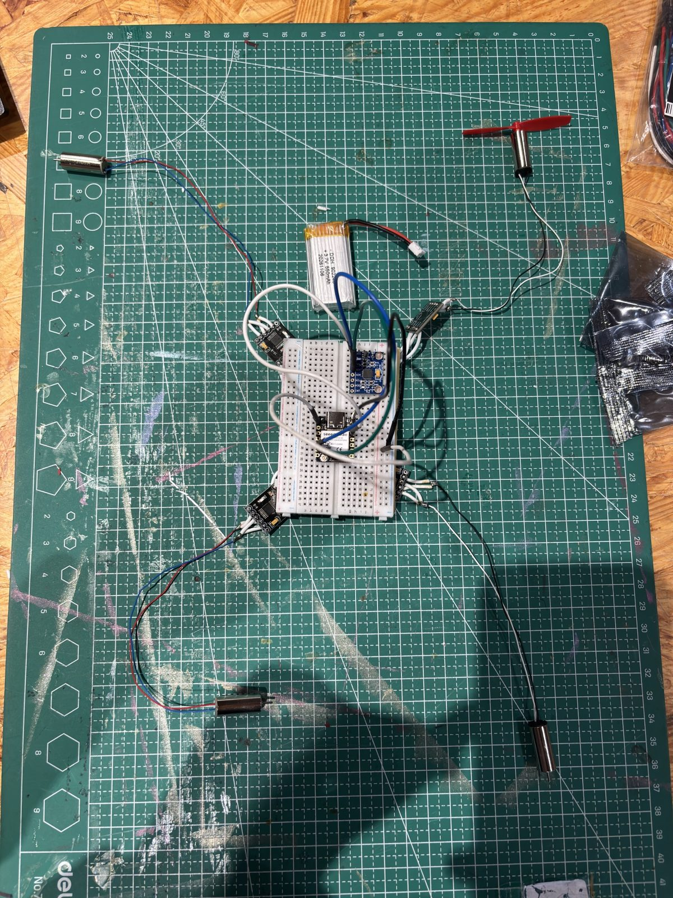
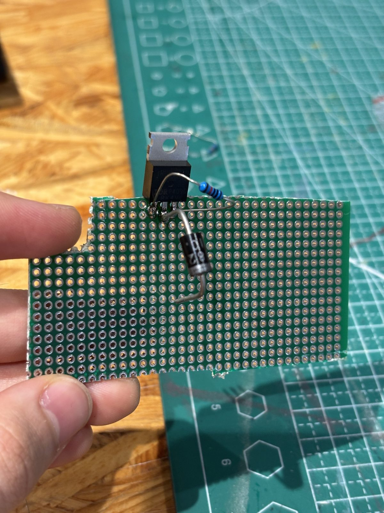
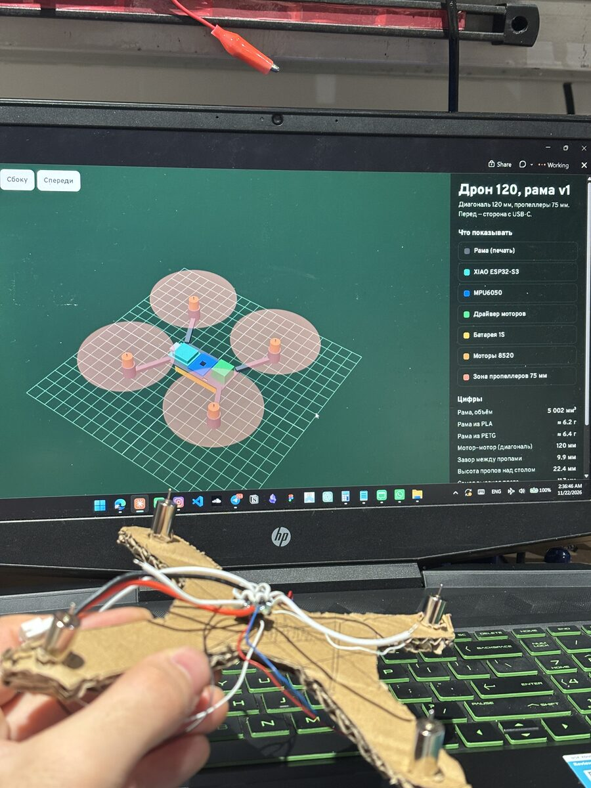

# Micro Drone — built from scratch

A palm-sized quadcopter built from individual components: my own motor-driver board, my own wiring, my own flight code. No off-the-shelf flight controller, no copied firmware.

> 📹 Video: _link coming soon_ · 📓 Full story: [BUILD_LOG.md](BUILD_LOG.md) · 💥 Everything that went wrong: [FAILURES.md](FAILURES.md)

## Why

1. **Learn by building.** I want to understand every layer of a drone — power electronics, sensors, control — instead of flashing someone else's firmware.
2. **A platform for reinforcement learning.** Once it flies on a classic PID controller, the next step is to train a control policy in simulation (PyFlyt / Gymnasium) and run it on the ESP32-S3 on board. Long-term goal: a drone that recovers from hits and can land after losing a motor.

## Where it is now (Nov 23, 2026)

- ✅ Self-built 4-channel MOSFET motor driver on a 4×4 piece of perfboard
- ✅ All four motors controlled independently from MicroPython
- ✅ Tilt angle from the gyroscope, calibrated (drift ~0.33°/min)
- ✅ PID (roll + pitch) running on the ESP32, mixing into four motors — tilt the drone and the right motors respond
- ✅ Frame v1: cardboard mock-up, then 3D-printed (Bambu Lab, ~20 min)
- 🔧 Fixing the motor numbering on the frame (code and frame disagreed — [FAILURES #23](FAILURES.md))
- ⬜ Test stand + PID tuning with props on
- ⬜ Complementary filter (accelerometer + gyro)
- ⬜ Frame v2 (better wire channels), first hover
- ⬜ RL policy trained in simulation, deployed on the drone

## Hardware

| Part | Choice | Why |
|---|---|---|
| Flight computer | Seeed XIAO ESP32-S3 | Tiny (~2 g), battery pads, memory for TinyML later |
| IMU | MPU6050 (GY-521) | Accelerometer + gyroscope over I2C |
| Motor drivers | 4× AO3400A MOSFET + SS34 diode + 10 kΩ, on one 4×4 perfboard | Replaced DRV8833 modules, which lost almost half the thrust on 1S (see below) |
| Motors | 4× 8520 coreless brushed (2 CW, 2 CCW) | Standard for micro quads, ~5.1 g each |
| Propellers | 55 mm, 75 mm to be tested | |
| Battery | 1S LiPo, 15.5 g (measured) | 3.7 V, PH2.0 connector |
| Bulk capacitor | 1000 µF 10 V | Absorbs voltage dips when motors start |

Details: [driver board](docs/driver-board.md) · [wiring](docs/wiring.md) · [parts list](docs/BOM.md) · [frame files](cad/)

### The thrust test that changed the design

One 8520 motor + 55 mm prop, measured on a kitchen scale:

| Driven by | Thrust |
|---|---|
| DRV8833 module (parallel mode) | ~20 g |
| Battery directly | ~35 g |
| MOSFET (IRLB8721 bench test) | 33 g (charged), 27–28 g (low battery) |

On a 3.7 V battery, a fraction of an ohm inside the driver costs almost half the thrust. So I designed my own driver with one low-resistance MOSFET per motor.

## Software

MicroPython on the ESP32-S3. The flight loop may move to C++ later for speed.

| File | What it does |
|---|---|
| [firmware/motor_test.py](firmware/motor_test.py) | Spin one motor at a throttle % typed in the terminal |
| [firmware/motors_manual.py](firmware/motors_manual.py) | Four motors, `20 0 0 0` style input |
| [firmware/motors_sequence.py](firmware/motors_sequence.py) | Spin motors one after another (check numbering and direction) |
| [firmware/mpu6050_read.py](firmware/mpu6050_read.py) | Print acceleration (g), rotation (°/s), temperature |
| [firmware/i2c_scan_debug.py](firmware/i2c_scan_debug.py) | Find the sensor when `ENODEV` shows up |
| [firmware/gyro_angle.py](firmware/gyro_angle.py) | Gyro calibration + tilt angle from rotation rate |
| [firmware/pid_one_axis.py](firmware/pid_one_axis.py) | PID on one axis, two motor outputs, anti-windup |
| [firmware/pid_4motors.py](firmware/pid_4motors.py) | Roll + pitch PID mixed into four motors, safety stops, status LED |

How the PID works, with numbers: [docs/PID_NOTES.md](docs/PID_NOTES.md)

## Weight budget

| Item | g |
|---|---|
| 4× motor (measured 5.1 g each) | 20.4 |
| Battery (measured) | 15.5 |
| XIAO ESP32-S3 (measured) | 2.0 |
| MPU6050 (measured) | 2.0 |
| Driver board with diodes and resistors (measured) | 1.4 |
| Frame (3D-printed v1, PLA — from the model) | ~6.2 |
| Props, capacitor, wires | ~5 |
| **Total** | **~52–55** |

With ~33 g per motor on a charged battery that's ~130 g of thrust, about **2.4–2.5 : 1**.

## Photos

| Day one: the plan | My 4-channel driver (1.4 g) | PID on a whiteboard |
|---|---|---|
|  |  |  |
| **Breadboard prototype** | **MOSFET bench test** | **Cardboard frame vs the model** |
|  |  |  |

More in [media/](media/).

## Credits

- The idea of making tiny single-MOSFET motor drivers came from MaxImagination's YouTube video *"Guide to making TINY Brushed Motor Drivers with MOSFETs"*. The 4-channel pinwheel layout on 4×4 holes is my own.
- Built at the NYU Shanghai fab lab. Claude was my tutor along the way and helped with the drawings, these docs and parts of the code; the circuits, the soldering and the PID derivation are mine.

## What I learned so far

Power electronics (low-side MOSFET switch, flyback diodes, gate pull-downs, why resistance matters at 3.7 V), reading datasheets, soldering SMD parts on perfboard, I2C, PWM, gyro calibration and drift, numerical integration and derivatives, PID from first principles, motor mixing for a quadcopter — and that a multimeter check before plugging in the battery saves hours.
