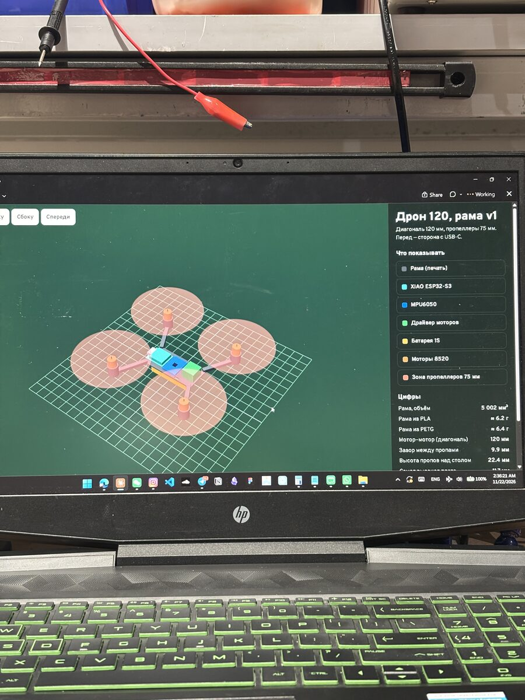
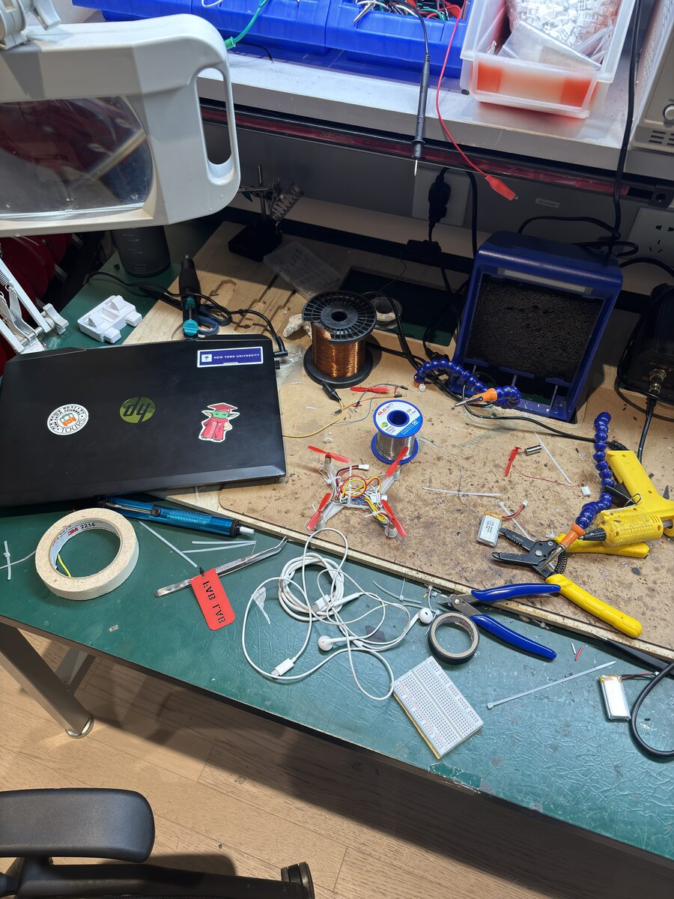

# Frame

## v1 (Nov 2026)

- Printed on a Bambu Lab printer at the university, ~16–20 minutes.
- From the model: **120 mm** motor-to-motor diagonal, **75 mm** props, **9.9 mm** gap between props, ~**6.2 g** in PLA (6.4 g PETG), 5 002 mm³. Front = the USB-C side.

 

- Model file: [`drone120_frame_v3.3mf`](drone120_frame_v3.3mf) — opens in Bambu Studio / PrusaSlicer. (the latest version of the file from Nov 22)

**What went wrong:** the motor holes were tight, so motors slipped in with a jolt; the wire channel under each motor squeezed the wires and bent them off the motor base. Fixed with a hot-glue cushion under each motor.

## v2 — to do

- Wires leave the motor to the side, not straight down
- Wider wire channel, chamfer on the motor hole
- Mount points for the driver board and the battery
- Weigh the printed frame (model says ~6.2 g) and update the weight budget in the README
