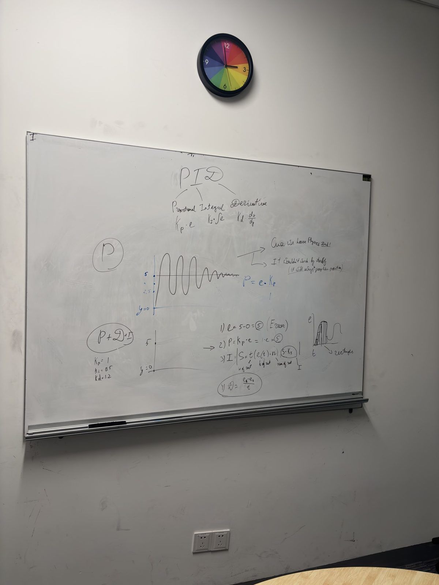
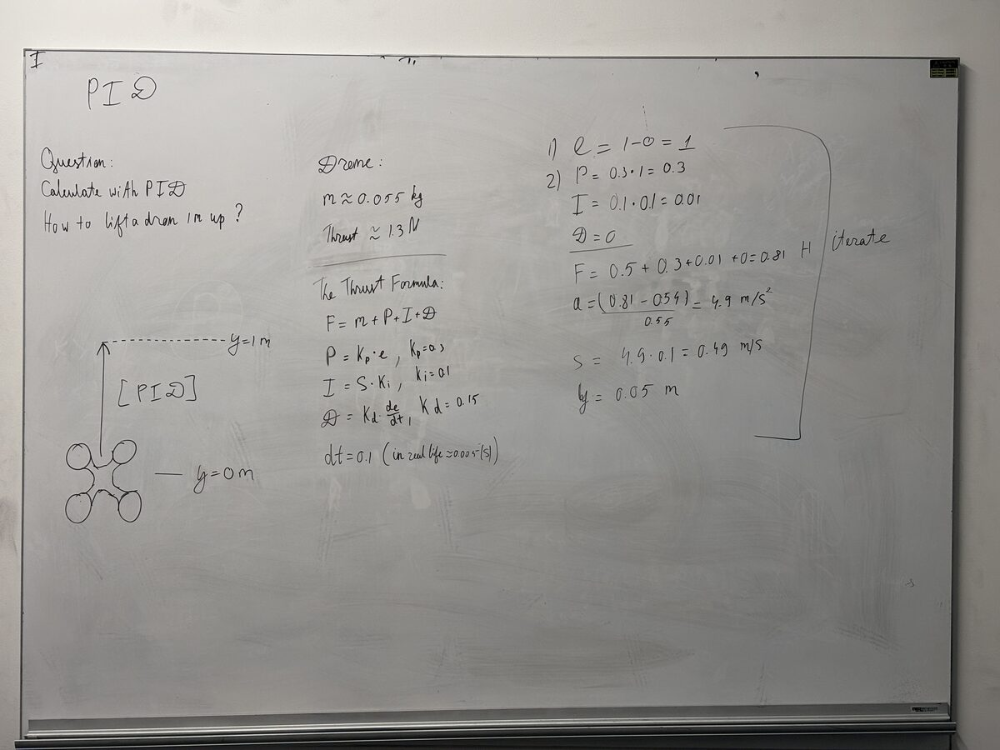

# PID, explained with numbers

My notes from learning PID from scratch (Nov 21, 2026). I watched many videos and still didn't get it, so I worked through it with real numbers until it clicked.



## 1. My first wrong idea

I thought the controller moves the drone directly:

```
y_new = y + Kp · e        (e = target − y)
```

With target 5 and Kp = 1 that jumps straight to 5 — so why not always use Kp = 1?

**Because a drone's controller doesn't set the position. It sets thrust.** Physics does the rest:

```
thrust → acceleration → speed → position
```

You can push a drone, you can't teleport it. And a drone that's moving keeps moving.

`Kp = 1` doesn't mean "close 100 % of the gap". It means "1 newton of thrust per metre of error" — it converts units.

## 2. P alone overshoots

Target 5, start at 0, mass 1, no gravity, force = 1 · e, one step = 0.5 s:

- t = 0: e = 5, force +5
- t = 1.0: y = 3.4, speed 4.4, force +1.6
- t = 1.5: y = **6.0**, speed **5.2** — passed the target at full speed
- t = 3.0: y = **10.1**
- t = 5.5: y = **0.4** — and back again, forever

P pushes less as you get closer, but it has no brakes. Bigger Kp = faster swing, smaller Kp = slower swing. It swings either way.

## 3. D is the brake

Force = 1 · e − 1.2 · speed:

- t = 0: P = +5, D = 0 → +5
- t = 0.5: P = +3.75, D = −3.0 → +0.75
- t = 1.0: P = +2.31, D = −3.45 → **−1.14** — braking while still 2.3 m away
- t = 5.5: y = **5.02**, settled

D looks at how fast the error is changing and pushes against it.

## 4. I is a piggy bank

Two motors on a stick, the right one slightly weaker: it needs +2 % extra to match the left one.

With P = 0.5 · angle and D, the stick stops at **4°**:

- at 4°: P = 0.5 · 4 = 2 → exactly makes up for the weak motor → nothing left to turn the stick → it stays
- at 3°: P = 1.5 < 2 → the stick drops back to 4°
- at 5°: P = 2.5 > 2 → it rises back to 4°

The forces are balanced, so the stick stops moving — but **balanced doesn't mean level**. Two people pushing a half-open door equally hard: the door stops, half-open.

This is **steady-state error**. On a real drone a constant 4° tilt means the thrust points slightly sideways: 9.8 · tan 4° ≈ 0.7 m/s², about **3 m sideways in 3 seconds**.

The fix is a piggy bank. Every step, put in `angle × dt`. The motor gets an extra `Ki × piggy_bank`:

- 4° for 1 s → bank 4 → +0.4 (with Ki = 0.1)
- after 5 s → bank 20 → +2 → the weak motor is covered
- now the stick is level, angle 0 → nothing is added, **nothing is taken out** → it keeps giving +2

P needs a tilt to produce force. I produces force from memory, with no tilt.

## 5. Integral and derivative without formulas

In class: integral of 6x = 3x², derivative of 3x² = 6x. But the drone has no formula — just one number from the sensor every few milliseconds. So you use what integral and derivative *mean*:

**Derivative = slope = change ÷ time between two points.**
Check: f(x) = 3x², f(2) = 12, f(2.01) = 12.1203 → (12.1203 − 12) / 0.01 = **12.03** ≈ 6 · 2 = 12 ✓

**Integral = area under the curve = sum of thin rectangles (height × width).**
Check: area under 6x from 0 to 2 = 3 · 2² = 12.
Rectangles 0.5 wide → 15, 0.1 wide → 12.6, 0.01 wide → 12.06 → closer and closer to 12 ✓

In code that's two lines:

```python
S  = S + e * dt              # integral: one more rectangle
de = (e - e_prev) / dt       # derivative: slope between the last two points
```

On a drone the gyroscope measures rotation speed directly — that number already **is** the derivative of the angle. And the angle itself is the integral of that speed: `angle += rate * dt`.

## 6. Lifting a 55 g drone to 1 m



*My whiteboard: step 1 (the steps below continue it).*

Weight = 0.055 kg · 9.8 = 0.54 N. Thrust = base 0.50 N (a bit too little, on purpose) + P + I + D. Kp = 0.3, Ki = 0.1, Kd = 0.15, step 0.1 s.

- **Step 1:** e = 1, P = 0.30, I = 0.01, D = 0 → thrust 0.81 N → accel 4.9 m/s² → height 0.05 m
- **Step 2:** e = 0.95, P = 0.285, I = 0.02, D = −0.074 → 0.73 N → height 0.13 m
- **Step 3:** e = 0.87, P = 0.26, I = 0.028, D = −0.126 → 0.66 N → height 0.24 m

P shrinks, D grows, I slowly fills up. With a 5 ms loop: 0.9 m after ~1 s, overshoot to 1.17 m between 1 and 2 s, exactly 1.00 m after ~10 s. At the end P = 0, D = 0 and **I = 0.039 N** — exactly the 0.04 N the base thrust was missing. I found it by itself.

(To actually hold altitude the drone needs a height sensor — the MPU6050 can't measure height. That's for later.)

## 7. From a stick to a quadcopter

One axis, two motors:

```
right = throttle + Kp·angle + Ki·S + Kd·rate
left  = throttle − (Kp·angle + Ki·S + Kd·rate)
```

Every sign checked with numbers: "angle +4, rotating back toward 0 at −40 °/s — does this term brake or push?"

Four motors, two axes: each motor gets **both** corrections. One axis splits the motors into **front vs back**, the other into **left vs right**. Diagonal motors always get opposite corrections — my first version had motors 1 and 3 with the same signs, and tilting the board showed both diagonals pushing together.

## 8. Things that bit me

- **Outputs must be clamped to 0–100 %.** 50 + 90° · 0.9 + D can be 130 %; `duty_u16` refuses it and the program crashes mid-flight.
- **Anti-windup:** limit the piggy bank to ±L with `L = I_MAX / Ki`, so I can never add more than `I_MAX` % of power. Otherwise one hit against a wall fills the bank and the drone keeps leaning long after.
- **Reset the bank on the ground** (low throttle) — errors there aren't real.
- **On the bench the bank keeps growing** — the motors don't move the board, so the error never goes away. On a flying drone the tilt changes and the error goes to zero.
- **Tuning order:** P until it starts to oscillate, then D until the oscillation stops, then a small I last.
