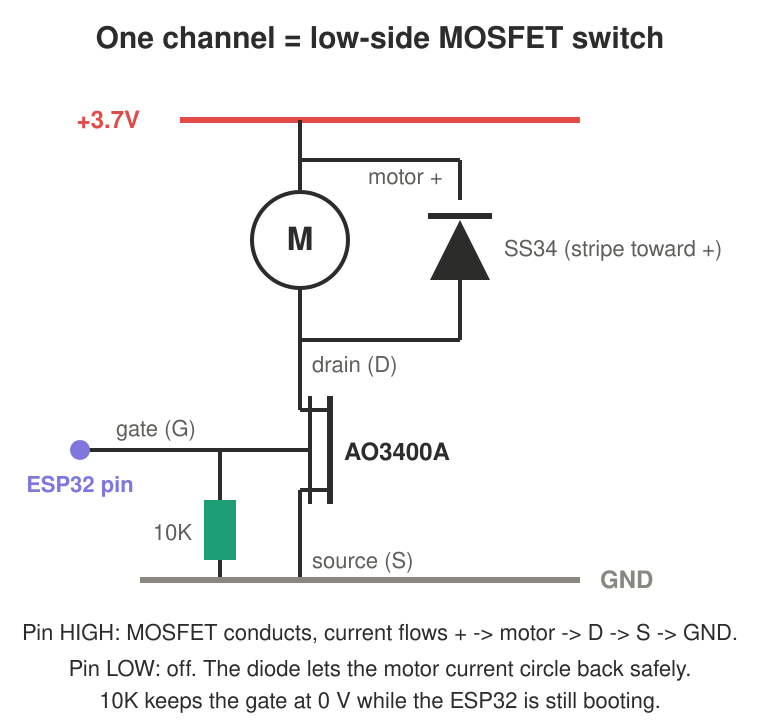
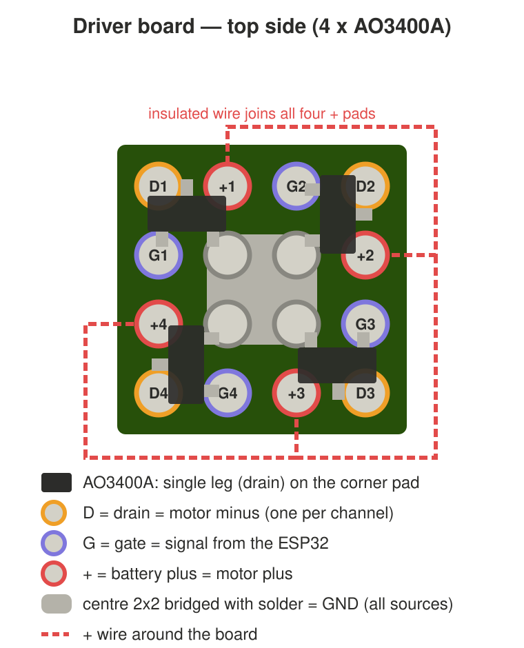
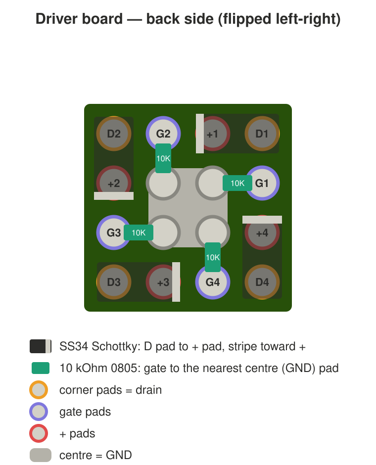
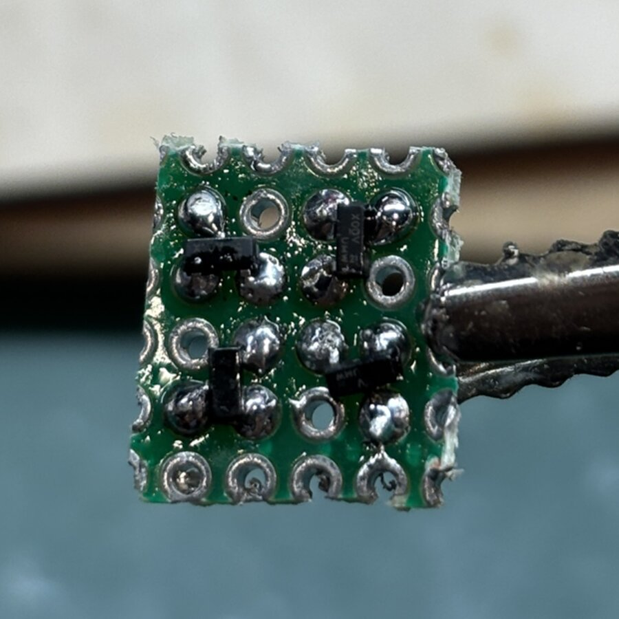
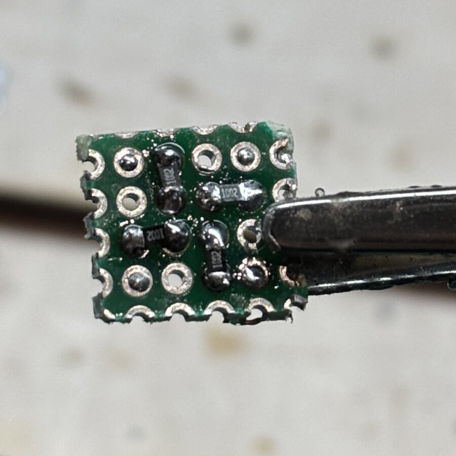
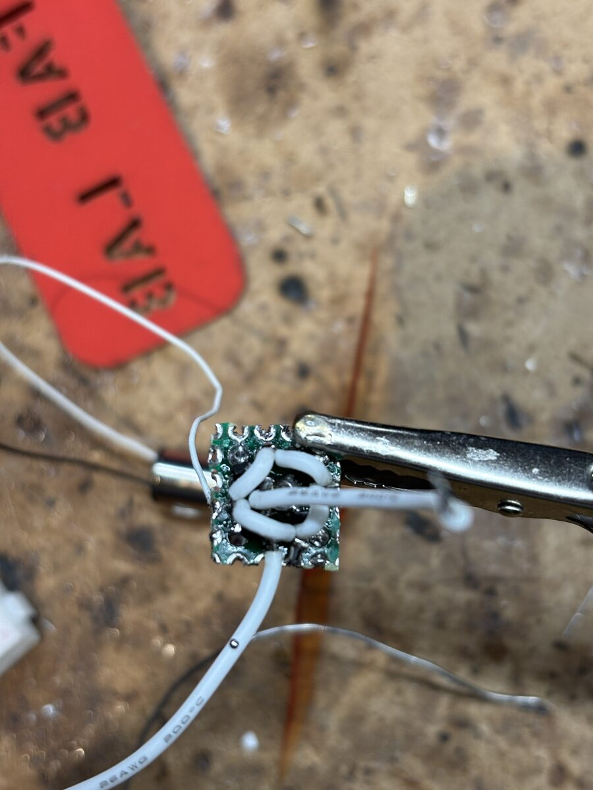
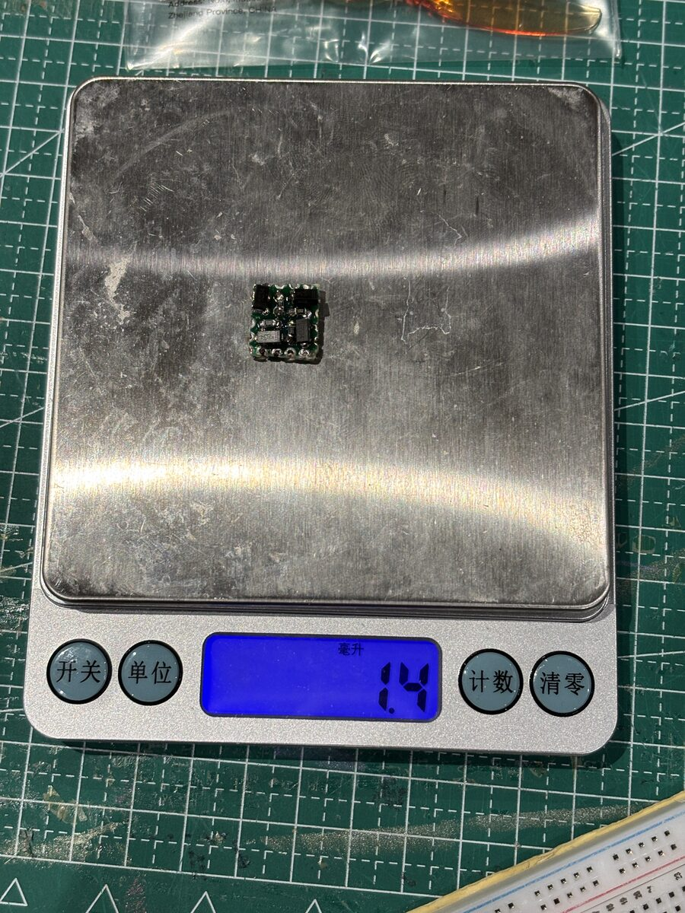

# Motor driver board — 4 channels on a 4×4 piece of perfboard

Hand-soldered on Nov 19, 2026. Replaces four DRV8833 modules, which lost almost half the thrust on a 1S battery (20 g vs 35 g per motor, see [BUILD_LOG](../BUILD_LOG.md)).

## One channel

Each motor gets a **low-side MOSFET switch**:

| Part | Value | Why this part | If you skip it / pick wrong |
|---|---|---|---|
| MOSFET | AO3400A (SOT-23, marking X0DV) | Logic-level: fully on at the ESP32's 3.3 V. ~43 mΩ at 2.5 V gate, 30 V, 5.8 A | A non-logic-level MOSFET stays half-open at 3.3 V, gets hot and loses thrust |
| Flyback diode | SS34 Schottky (3 A, SMA) | A motor is a coil: when the switch turns off, its current needs a path. Schottky = fast, low drop | Voltage spike on the drain every PWM cycle → can kill the MOSFET |
| Gate pull-down | 10 kΩ 0805, gate → GND | Holds the gate at 0 V while the ESP32 boots and its pins float | Motors can twitch or spin at power-up |

The diode stripe (cathode) always points to **+**.

## Layout: "pinwheel" on 16 holes

The circuit uses 4×4 holes; the actual piece is 5×4 — perfboard snaps rather than cuts, so I kept a spare row.

AO3400A legs are 1.9 mm apart, perfboard holes 2.54 mm. Shifting each transistor slightly sideways lets all three legs reach three holes. Each corner of the board is one channel; the four transistors are rotated 90° from each other so that all four sources meet in the centre.

| Top side | Back side (flipped like a page) |
|---|---|
|  |  |

| Real board, top | Real board, back |
|---|---|
|  |  |

- **Top:** 4× AO3400A. Single leg (drain) on the corner pad, the other two legs on gate and on a centre pad (source).
- **Back:** 4× SS34 (drain pad → + pad, stripe to +) and 4× 10 kΩ (gate → nearest centre pad).
- **Centre 2×2** bridged with solder = common ground for all four channels.
- **The four + pads are in four different corners and are NOT connected on the board.** An insulated wire runs around the edge and is soldered to all four (insulation stripped only at the joints). The battery + goes to any of them.

Per motor: motor minus → its corner (drain) pad, motor plus → its + pad.

## Checks before the battery goes on (continuity mode)

1. + pad ↔ + pad, all four → **beep**
2. + ↔ centre (GND) → **no beep** (a beep here = short-circuited battery)
3. + ↔ every gate pad → **no beep** (a bridge here puts 4.2 V on a 3.3 V ESP32 pin)
4. Gate ↔ GND → **≈ 10 kΩ**
5. Drain ↔ GND, red probe on drain → **no beep**
6. Diode mode, red on drain, black on + → **0.2–0.3 V**; reversed → OL. 0.00 = solder bridge.
7. ESP32 GND pin ↔ centre → **beep**

With a motor connected, + ↔ drain beeps through the motor coil (1–3 Ω). That's normal.

## Tested

- One motor: ~33–35 g of thrust (DRV8833 gave ~20 g).
- **Weight: 1.4 g** for all four channels with diodes (0.5 g before the diodes went on). One DRV8833 module with wires was 2.1 g.

- Two motors running at once on the finished board: no overheating.

## Mistakes I made building it

- The ESP32 ground joint wasn't actually soldered → no common ground → MOSFETs never opened.
- I didn't connect the four + pads → only the motor next to the battery wire worked.
- First SMD attempt: far too much solder and burnt flux. Less solder, more flux, 320–350 °C, clean with alcohol.
- Motor wires soldered directly to pads will tear the pads off → glue the wires to the board.

## Credit

The idea of single-MOSFET drivers for tiny brushed motors came from MaxImagination's YouTube video *"Guide to making TINY Brushed Motor Drivers with MOSFETs"*. Fitting four of them on 4×4 holes (the pinwheel) is my own layout.
