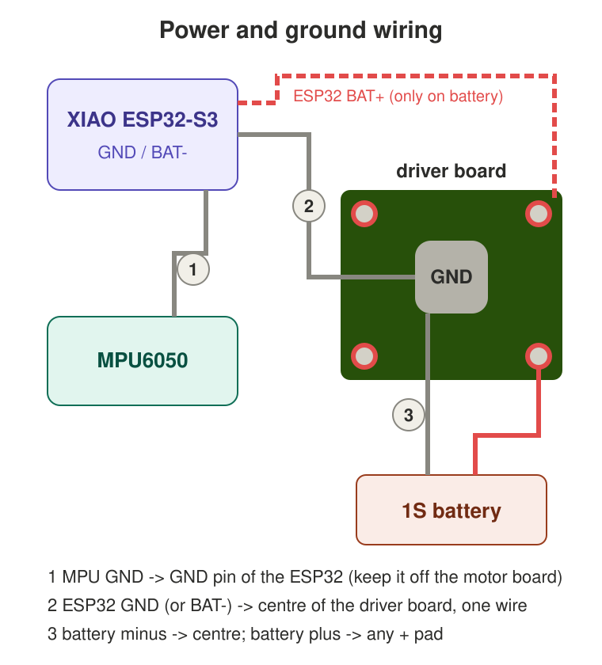

# Wiring

## Pin map (XIAO ESP32-S3) — current, on the frame

Board labels are **not** GPIO numbers. MicroPython uses GPIO numbers.

| XIAO label | GPIO | Used for |
|---|---|---|
| D7 | 44 | Motor signal, slot 1 in `PINS` |
| D8 | 7 | Motor signal, slot 2 |
| D4 | 5 | Motor signal, slot 3 |
| D5 | 6 | Motor signal, slot 4 |
| D10 | 9 | I2C SDA → MPU6050 |
| D9 | 8 | I2C SCL → MPU6050 |
| 3V3 | — | MPU6050 VCC |
| GND | — | MPU6050 GND, and one wire to the driver board centre |
| BAT+ / BAT− (back pads) | — | 1S battery, when not on USB |
| — | 21 | Built-in user LED (on at 0): status light in `pid_4motors.py` |

In code: `PINS = [44, 7, 5, 6]` and `I2C(0, sda=Pin(9), scl=Pin(8))`.

**Which slot is which corner** is set only by the order of `PINS`. `mix()` in [pid_4motors.py](../firmware/pid_4motors.py) expects the slots in this order (top view, nose forward): **front-right, front-left, rear-left, rear-right**. If a slot spins the wrong corner, reorder `PINS` — don't change the formulas. Check with [motors_manual.py](../firmware/motors_manual.py): `20 0 0 0` must spin the front-right motor. (Nov 23: this is exactly what was wrong — see [FAILURES #23](../FAILURES.md).)

- **D7 is UART0 RX** — the motor on it may twitch at power-up, before the code starts. Always test power-up with props off.
- Avoid D2 (GPIO3) — strapping pin.
- The 5V pin is dead on battery power — never power sensors from it.
- The first wiring (breadboard and cardboard frame) used D0, D6, D7, D9 for the motors and D4/D5 for I2C. Older scripts in `firmware/` say which pins they expect at the top.

## Power and ground

- **Battery −** → centre of the driver board (all motor current returns here).
- **Battery +** → any + pad of the driver board (all four + pads are joined by a wire).
- **ESP32 GND** → centre of the driver board, one wire. Without a common ground the MOSFETs never open.
- **MPU6050 GND** → GND pin of the ESP32, **not** the driver board — motor current makes the ground there noisy.
- 1000 µF capacitor across battery + and − near the driver board (stripe = minus).

## Motors

- Motor minus (blue or black wire) → that channel's drain (corner) pad.
- Motor plus (red or white wire) → that channel's + pad.
- Swapping the two wires is safe — the motor just spins the other way.
- Diagonal motors spin the same direction; neighbours spin opposite. Check by hand with a prop: air must blow **down**.

## Driver board

See [driver-board.md](driver-board.md).
